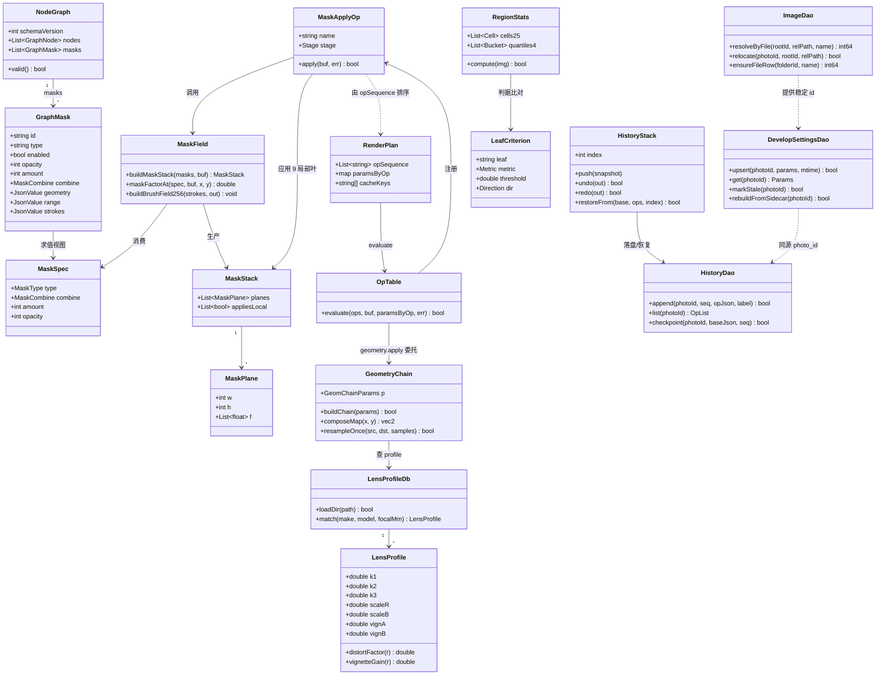
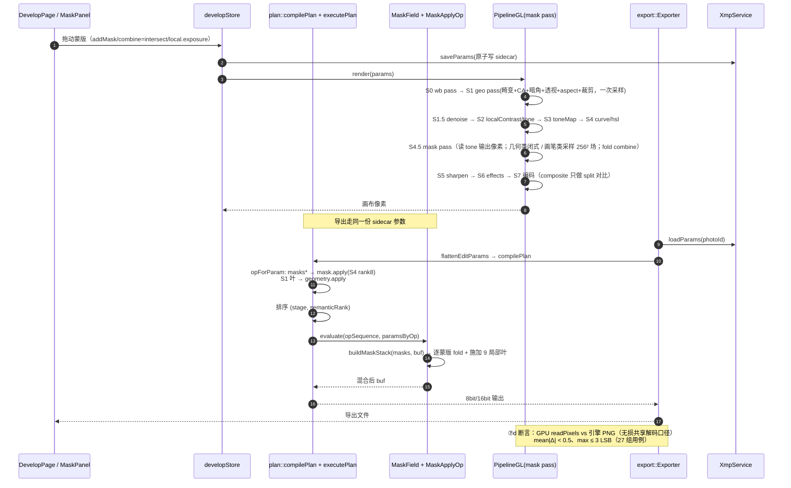
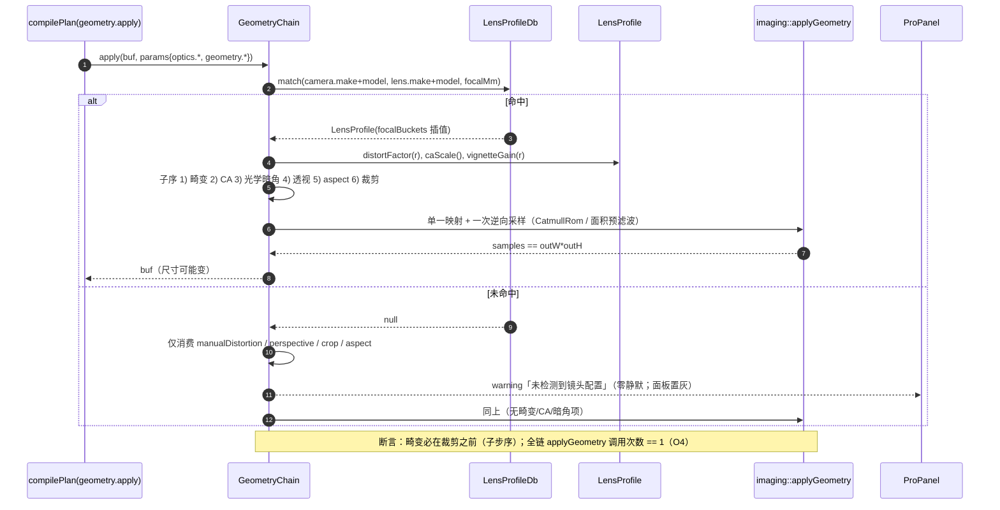
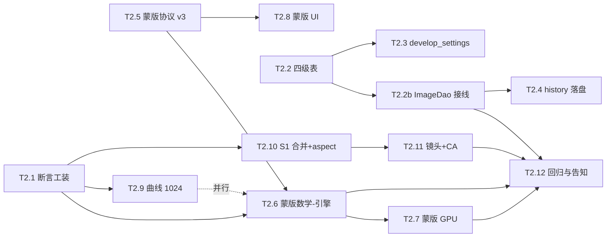

# LUMINA v1.2.0 · M2「LR 闭环」增量架构设计与任务分解

> 文档版本：**v1.2.0-ARCH-M2-1.4** · 日期：**2026-10-26**（v1.1–v1.4 同日修订，见下「修订记录」） · 作者：架构师 高见远（Gao）
> 性质：**增量设计**。不推翻 `docs/架构设计-LUMINA-v1.2.0.md`（下文简称「总架构」）与 M1 关账结论（HEAD `b62d179`，ctest 15/15），只补 M2 的实现落点与任务分解。
> 需求依据：`docs/v1.2.0/M2-增量PRD.md`（v1.2.0-PRD-M2-1.0）、`docs/v1.2.0/v1.2.0-启动-对标路线与范围冻结.md` §5.1/§5.2/§5.3、`docs/PRD-LUMINA-v1.2.0.md` §1.3、`docs/v1.2.0/M1-覆盖矩阵.md` §三/§五。
> 已拍板决策（不得改动）：**D1** 不发止血版；**D2** 节点 = 参数组、8 节点 = 8 面板；**D3** 自有色彩科学、禁「像 LR/等同 ACR」表述；**D4** LibRaw 静态链接 + §6 relink 材料、不宣传 clean-room；**Q1** 四级表进 P0 且排在 history/缓存之前；**Q2** 蒙版交集+相减进 P0、反相留 P1、SchemaVersion 2→3；**Q3** 内置常见镜头库（禁 Adobe LCP/DCP）+ CA「无参自动 + 1 强度叶」、93→94 叶口径变更；**Q4** 曲线 LUT 256→1024 进 P0；**Q5** 分区统计器分区表与阈值由架构定（本文件 §3.6）。
>
> **本文不含代码改动**。所有路径为绝对路径，工程根 `D:/LUMINA`。

**修订记录**

| 版本 | 日期 | 变更 | 触发 |
|---|---|---|---|
| 1.0 | 2026-10-26 | 初版：六条主线 + 12 任务 77 人日 | 任务 #2 |
| **1.4** | 2026-10-26 | ① **T2.12 增加「存量 `sidecar_path` 失效行扫描与修复」**（migration 005 `repair_sidecar_paths` + `test_sidecar_repair.cpp` + `{home}/reports/m2-sidecar-repair.json`），人日 4→5；② §3.3.1 末尾新增「存量数据修复」小节（判定/修复/不可恢复/报告/断言五条）；③ T2.12 blockedBy 加 T2.2b；④ 合计 81→82 人日；⑤ 版本 1.3→1.4 | team-lead：只修代码不修数据，存量用户参数仍读不到 |
| **1.3** | 2026-10-26 | ① T2.2b 验收改为**真实使用路径**（移动文件夹 + 重新导入 / 两个 relocate 入口各验四条断言 / mock+HDR 回归 / id 自检不可绕过），明确「relocate() 返回成功」不算验收；② 补第二处路径手术入口 **`health.resolveIssue`**（`methods.cpp:1358-1370`），I3 由「一处」改为「两处」；③ 核实并写明：`import/scanner.cpp` **无 DB 写入**（不改）、**不存在 `folder_dao.*`**（`ensureRoot`/`ensureFolder` 在 `photo_dao`）；④ §3.3.1 I3 行同步；⑤ 版本 1.2→1.3（结论与 81 人日不变） | team-lead 要求 T2.2b 验收须防「测了 API 没测真实路径」的假绿 |
| **1.2** | 2026-10-26 | ① **新增 T2.2b「ImageDao 接线到导入/移动/重命名」3 人日**（T2.2 只建表不接线 = 四级表收益归零）；② 新增 §3.3.1「身份迁移三步 I1/I2/I3」并指出 `photos.upsert` 的 `ON CONFLICT(file_path)` 是最后一处路径身份残留、`relocate` 未重算 `sidecar_path` 是真缺陷；③ T2.4 blockedBy 加 T2.2b（history 键必须等身份闭环）；④ §2.3 新增 M34/M35/M36；⑤ 合计 78→81 人日 | team-lead 指出 ImageDao 未接线（T2.2 交付核查） |
| **1.1** | 2026-10-26 | ① §3.6 结构体与判据表按 T2.1 落地实现对齐（新增 `maxCellChromaDeltaAbs`、`chromaVarRelChange`、逐像素平面）；② **新增 §3.6.1 指标选择规则**（幅度/位移/色相旋转/通道方差四类禁令）；③ 判据表新增 **step 列与实测基线列**；④ **新增 §3.6.3 口径修订登记 R-1/R-2/R-3**（colorNR 判据原式数学不可执行、tint 带符号判反、grain step 缺失）；⑤ §3.7 O2 拆「语义性 / 码域性」两组并强制断言 clamp 依赖；⑥ 新增 **O2 零 SKIP 出口要求**；⑦ **新增 §3.7.1 `kPipelineOrder` 表驱动收口**（归属 T2.10）；⑧ §5 同步 T2.1/T2.6/T2.10 验收；⑨ §7 新增 S14/S15，S10 扩到 step；⑩ T2.10 人日 7→8（吸收表驱动收口），合计 77→78 | kou-eng 反馈 5 处 + 1 处归属缺口 |

---

## 0. 一页结论

| 项 | 结论 |
|---|---|
| 六条主线 | ①蒙版数学（引擎权威 + GPU 镜像）②history 落盘（diff 派生日志）③曲线全谱精度（256→1024）④镜头校正（自建 profile + CA 新叶 + S1 单次采样）⑤库内参数缓存 + 四级表（Q1 先做）⑥断言工装（分区统计器 + 20 阶段顺序表） |
| 最大结构性改动 | **S1 由 5 个算子合并为 1 个 `geometry.apply`（组合映射、唯一一次重采样）**，同时收口 `geometry.perspective.aspect` 死叶与畸变/裁剪顺序不一致（O4/O3/L1） |
| 蒙版落点 | 引擎 `mask.apply` 从 IdentityOp 改为**真实算子**，仍在 `S4Color`（semanticRank = 8，即曲线/HSL 之后、锐化之前）；**GPU 新增独立 `mask` pass 插在 `tone` 与 `sharpen` 之间**（现为末道 composite 内联，与引擎顺序不一致） |
| 三个 M1 遗留 | ①`masks[]` 纳入 parity：新增 ⑦d 用例（3 类型 × {1,3,20} 槽 × combine 三态），机器判据 mean<0.5 / max≤3；②`aspect` 实装为「输出宽高比约束」（0=自由），四角/尺寸可测；③K2/K3 换口径：25 格 + 亮度四分位 + 局部方差 + 色度（局部） + 边缘梯度，判据表固化进 CI（含 step 与实测基线列，见 §3.6.2/§3.6.3） |
| 叶数口径 | **93 → 94**（新增 `optics.chromaticAberration`，Q3 已批）；`masks[]` 纳入 parity 与 `aspect` 实装**不改叶数**，走「覆盖格补齐」而非分母变更 |
| 任务 | **T2.1–T2.12 共 13 个任务（含 T2.2b），82 人日**（冻结口径 60 人日 → 重算 +22，见 §8 待明确 #1） |
| 必须串行 | `T2.1 → T2.6 → T2.7 → T2.12`（断言口径 → 蒙版引擎 → 蒙版 GPU → 回归）；`T2.2 → T2.2b → T2.4`（键稳定性 + 身份闭环）、`T2.2 → T2.3`；`T2.5 → T2.6`；`T2.10 → T2.11` |

---

## 1. 实现方案总览

### 1.1 六条主线与现有结构的对应

| # | 主线 | 现状（证据） | M2 落点 | 复用 M1 的什么 |
|---|---|---|---|---|
| ① | **蒙版数学** | `plan/ops/mask.cpp:68-74` `MaskApplyOp` = IdentityOp；`render_plan.cpp:50` 把 `masks*` 全路由到它 → 导出 100% 丢蒙版；GPU 在末道 composite 内联、display 域近似、`[6]` 常量展开 | 引擎：`plan/ops/mask.cpp` 实装 + 新增 `plan/ops/mask_field.{h,cpp}`（蒙版平面生产者）；GPU：`ops/glsl.ts` 新增独立 `mask` pass、`ops/pipeline.ts` 插 pass、`renderer.ts` 传数据纹理 | 复用 `applyMasked` 混合语义骨架（`mask.cpp:17-62`）、`GraphMask`/`graph.serialize`、`opForParam` 路由、`ImageBuf` float 工作链 |
| ② | **history 落盘** | `edit/history.cpp` 45 行纯内存；`schema.sql` 无表；`edit_session.cpp:36` 只 `push(params)` | 新增 `db/history_dao.{h,cpp}` + `schema.sql` 两表 + `history.{h,cpp}` 加 diff 编码/折叠；`edit_session.cpp` 挂 begin/commit 钩子 | 复用 `HistoryStack` 的 index/undo/redo 语义与 `edit_session` 的 500ms 防抖 flush 机制；`snapshots` 表语义边界不动 |
| ③ | **曲线全谱精度** | `ops/curve.cpp:15-33` 256 点 LUT（`lut[i]=i` 域）→ 16bit 输入被量化到 8bit 档位 | `curve.cpp` LUT 256→1024 + 线性插值；GPU 曲线纹理 256→1024；`oracle93.ts buildCurveLutData` 同步 | 复用 M1 已注册的 5 个曲线算子（覆盖 11 叶）与 `parseCurve` 产物格式，只换 LUT 密度与查表方式 |
| ④ | **镜头校正** | `ops/lens.cpp:69-79` `LensProfileOp` identity；无 CA 算子；畸变与裁剪各自重采样（2 次，违 O4） | 新增 `plan/lens_profile.{h,cpp}`（自建库加载/匹配/Brown-Conrady 求值）+ `plan/geometry_chain.{h,cpp}`（S1 组合映射，一次采样）；`ops/geometry.cpp`/`ops/lens.cpp` 退化为参数入口；新增叶 #94 | 复用 `applyGeometry` 的单应 + 采样计数机制、`ops/lens.cpp` 的双线性重映射骨架、`semanticRank` 同 stage 排序表 |
| ⑤ | **库内缓存 + 四级表** | `schema.sql` 无 `develop_settings`/`history`；`photos.file_path` UNIQUE 即身份；`plan/cache_key.h` 只是内存渲染缓存键（不是库内参数缓存） | `db/migrations.cpp`（版本化、幂等）+ `db/files` 表 + `photos.file_id` 列 + `db/image_dao.{h,cpp}` + `db/develop_settings_dao.{h,cpp}` | 复用 `Database::runMigrations` 的 `schema_meta.db_version` 机制、`PhotoDao` 的 `prepareCached` 语句缓存、`photos_fts` 触发器（**不重建 photos 表**） |
| ⑥ | **断言工装** | 8bit 整幅均值对保均值/零均值/小面积效应不灵敏（K2/K3）；无 `test_pipeline_order.cpp`；⑦c 传 `masks: []` | 新增 `tests/support/region_stats.{h,cpp}` + `tests/support/leaf_effect_table.h` + `tests/test_pipeline_order.cpp`；`app/src/smoke.ts` 新增 ⑦d | 复用 `tests/parity/harness.cpp`、`app/src/modules/develop/webgl/ops/parity93.ts`（已有 masks 注入钩子，line 71/264-274）、⑦c 的无损 PNG 共享解码口径 |

### 1.2 蒙版：为什么把 GPU 蒙版从「末道 composite」挪到「tone 之后」

现状三端顺序不一致（这是 M1 未暴露的**顺序型隐患**，与 K1「一致地错」同类但方向相反——此处是「不一致地各自对」）：

| 端 | 蒙版执行位置 | 域 | 后果 |
|---|---|---|---|
| 引擎 | `S4Color`（但 IdentityOp） | 显示码域 | 不生效 |
| GPU | 全部 pass 之后（含暗角/颗粒之后），末道 composite | 8bit sRGB 0..1 | 局部调整会**放大已加的颗粒**，且与引擎位置不同 |
| 导出 | 无 | — | 静默丢失 |

M2 定为：**蒙版 = S4 末位（曲线/HSL/分级之后、锐化/效果之前）**，理由：
1. 蒙版局部调整（exposure/contrast/highlights/shadows/temperature/tint/saturation/clarity/dehaze）本质是「基础面板的局部版本」，语义位置就在色调/颜色之后；
2. 锐化与暗角/颗粒必须在蒙版之后（LR 顺序），否则颗粒被局部曝光放大；
3. `S4Color` 已经是「感知码域（`code/65535` = 显示值）」，与 GPU 的 `c∈[0,1]` **同域**，无需新增 Stage 枚举、不改 `stageAllowedAfter` 校验；
4. 只改 `semanticRank`（`mask.apply` = 8）+ GPU 插一个 pass，改动面最小。

### 1.3 S1 合并为单一算子（O4 一次采样的唯一解）

现状 `semanticRank` 已把 `lens.profile(0) → lens.manualDistortion(1) → geometry.crop(2) → geometry.perspective(3)` 排好，但**每个算子各自 `applyGeometry` 一次重采样**：畸变 1 次 + 裁剪/透视 1 次 = 2 次，O4 必失败；且 GPU 侧是「geo(crop+perspective) 先、distort 后」，与引擎「畸变先、裁剪后」**顺序相反**（L1 四角位移方向会因此不同）。

M2 定为：**S1 只保留一个算子 `geometry.apply`**，消费全部 S1 叶（`optics.lensProfileEnable / optics.manualDistortion / optics.chromaticAberration / geometry.*`），内部按固定子序构建**单一映射**并**只采样一次**：

```
子序（GeometryChain，逐项断言）：
  1) profile 畸变（Brown-Conrady k1/k2/k3，径向）
  2) CA 通道缩放（R/B 径向缩放 s_r / s_b，无参自动时由 profile 或边缘相关估计）
  3) profile 光学暗角（径向增益，仅乘不采样）
  4) 透视（vertical/horizontal/rotate/scale/x/y → 单应）
  5) 比例约束 aspect（各向异性缩放 kx，见 §1.5）
  6) 裁剪 + 拉直（在 (4)(5) 的目标坐标系里取矩形）
  7) 输出网格 targetW×targetH + 一次逆向映射采样（CatmullRom；缩小 >2× 走面积预滤波）
```

`opForParam` 改为把上述全部叶路径路由到 `geometry.apply`（一个算子消费多叶已有先例：`detail.denoise` 3 叶、`curve.parametric` 7 叶、`color.hsl` 24 叶）。旧算子名 `lens.profile / lens.manualDistortion / geometry.crop / geometry.perspective` **退役**（M1 的验收对象是「叶」，不是算子名，故不影响 93/94 叶口径）。

### 1.4 蒙版规范（引擎权威，GPU 逐字镜像）

| 项 | 规范 |
|---|---|
| 坐标空间 | **裁后归一化 uv ∈ [0,1]**，`u = (x+0.5)/outW`、`v = (y+0.5)/outH`，v 向下（图像顶 = 0）。引擎在 S4 时 buf 已是裁后尺寸；GPU mask pass 的 FBO 也是裁后尺寸 → 两端天然一致，裁剪改变时蒙版不漂移（US-4 ②） |
| 平面生产者 | 引擎 `MaskField`（`plan/ops/mask_field.cpp`）；GPU 在 `mask` pass 内逐像素闭式求值（几何类）或采样场纹理（画笔类） |
| 类型覆盖 | P0：`linear` / `radial` / `brush` / `luminanceRange` / `colorRange`。**置灰不静默**：`depth` / `aiSky` / `aiSubject` / `aiBackground` 在协议与 UI 保留但显式「本版不支持（v1.3）」，且 A5 静态检查禁止「回落画笔分支」代码路径 |
| 画笔场 | 规范 = **256×256 单通道距离场 + 双线性采样**（沿用 `maskField.ts` 的 `FIELD_CELL=256`、`smoothstep5(r/2, r, d)`、画笔组取 max / 擦除组乘法衰减）。引擎在导出时**构建同一 256² 场再双线性采样**，从而与预览严格同式（代价：导出边界为 256 场插值分辨率，登记为已知限制） |
| 槽位 | `MAX_MASKS` 6 → **32**（PRD 要求 ≥20）；画笔图集 3×2=6 槽 → **4×8=32 槽**（1024×2048 单通道，2MB） |
| 范围蒙版 | 基于**进入蒙版阶段的像素**（引擎 = S4 末 buf；GPU = tone pass 输出）。亮度：`low/high` + `smooth`；颜色：色相窗口 `hueCenter ± hueWidth` + 饱和度 `[satLow, satHigh]`，色相环绕按最短弧 |
| 布尔组合 | `combine ∈ {replace, intersect, subtract}`（Q2：反相留 P1）。按 `masks[]` 数组序 fold（见 §3.1.3） |
| 局部算子 | 9 叶，公式见 §3.1.4；`clarity` 使用**共享盒式模糊平面**（半径 10，与 `basic.clarity` 同半径；每次渲染只算 1 次，N 个蒙版共用） |
| 语义变更 | `amount`（−100..100）从「曝光附加量」重定义为**蒙版强度倍率**（`f_eff = f * amount/100`，负值 = 反向调整）。此项改变存量 3,639 张观感，必须进差异报告（§5 T2.12） |

### 1.5 `geometry.perspective.aspect` 死叶收口（R7 强制）

| 项 | 设计 |
|---|---|
| 语义（M2 定义） | **输出宽高比约束**：`0` = 自由（保持源比例）；`>0` = 目标宽高比 × 100（如 100=1:1、133=4:3、150=3:2、177=16:9） |
| 实装 | 在 S1 映射的 (5) 步施加各向异性缩放：`kx = targetAspect / sourceAspect`，限幅 `[0.5, 2.0]`；输出网格随之变化，**不改变单应本身**（可逆、可镜像） |
| 可测性（O3） | `aspect ≠ 0` 时输出 `outW` 变化 ≥ 1px **且**四角映射位移 ≥ 1px；`aspect = 0` 时严格 identity（`max|Δ| = 0`） |
| 两端一致 | `oracle93.ts buildGeomTransform` 与 `glsl.ts FRAG_GEO` 同步（否则 ④ parity 会从「一致地忽略」变成「不一致地生效」，比死叶更糟） |
| 叶口径 | **不改叶数**（叶 #90 从「忽略」变为「生效」） |

### 1.6 断言工装（Q5：口径先立）

M2 的验收合法性依赖「局部统计」，因此**T2.1 必须最先做**（PRD §6.6 定性为 M2 前置闸门）。

| 指标 | 定义 | 用途 |
|---|---|---|
| 5×5 网格 | 每格 `{meanLum, meanA*, meanB*, varLocal, edgeEnergy, count}` | 蒙版区内外、局部调整方向 |
| 亮度四分位桶 | 按**基线亮度**排序分 4 桶（同桶像素集合固定），每桶同上统计 | dehaze（暗桶）、highlights/shadows |
| 局部方差 | 16×16 块方差的均值 | 保均值算子（clarity/texture/sharpness/colorNR/grain） |
| 色度 | CIE Lab 的 `a*, b*`（由显示 sRGB 反算 D65 白点）均值与方差 | temperature/tint/vibrance/saturation/blueSat/colorNR |
| 边缘梯度能量 | Sobel 幅值和 / 像素数 | sharpness |
| 零均值判据 | 整幅 `mean|Δ|` 与局部方差联合 | grain（均值必须 ≤1 LSB 且方差上升） |

**关键设计（Q5 硬要求：必须能区分「保均值算子」与「无操作」）**：
- `assertEffective(leaf)` = 该叶判据表中的指标**超阈值**；
- `assertNoOp(leaf)` = **全部**指标 ≤ 阈值的一半；
- 二者互斥且都由同一 `RegionStats` 差分产生 → 8bit 整幅均值口径保留为回归项（不删），但**不再作为唯一判据**。

阈值表固化在 `engine/tests/support/leaf_effect_table.h`（CI 只读，开发侧不得下调；只许收紧）。

### 1.7 三个 M1 遗留/新发现问题的收口对照

| # | 问题 | M2 收口动作 | 机器判据 | 责任任务 |
|---|---|---|---|---|
| 1 | `masks[]` 从未纳入 parity（导出静默丢蒙版，违 R3） | `mask.apply` 实装 + GPU 独立 mask pass + ⑦d 用例纳入 `masks[]` | ⑦d：`mean|Δ| < 0.5`、`max ≤ 3 LSB`（3 类型 × 3 槽数 × 3 combine 共 27 组） | T2.6 / T2.7 |
| 2 | `geometry.perspective.aspect` 死叶（三边一致地忽略） | 实装为输出宽高比约束（§1.5），两端同步 | O3：`aspect≠0` → `outW` 变化 ≥1px 且四角位移 ≥1px；`aspect=0` → `max|Δ|=0` | T2.10 |
| 3 | K2/K3 口径局限（保均值/零均值/小面积不灵敏） | 分区统计器 + 判据表（§1.6） | K2 的 10 叶 + K3 dehaze 全部 `assertEffective` 且方向正确；`assertNoOp` 反例同时成立 | T2.1 |

> 纪律复述：**不得**把 M1 的 93/93 写成「蒙版也覆盖了」。M1 覆盖矩阵 §三 ④ 原文即「masks[] 除外」；M2 交付后才可写「94/94 含 masks[] parity」。

---

## 2. 文件列表

### 2.1 归属纪律（硬约束，评审即拒）

| 层 | 允许改动的范围 | 禁止 |
|---|---|---|
| **engine** | 仅 `D:/LUMINA/engine/**` + `D:/LUMINA/docs/param-leaves.json`（口径登记） | 不得改 `app/**`；不得引入 Qt/浏览器依赖；不得在 `plan` 层依赖 `rpc`/`export` |
| **app** | 仅 `D:/LUMINA/app/src/**` | 不得改 `engine/**`；不得在渲染层引入第二套参数常量表（参数唯一来源 = `protocol.ts` + 引擎 Plan） |
| **docs** | 仅 `D:/LUMINA/docs/v1.2.0/**`、`docs/param-leaves.json` | **禁止读写 `D:/LUMINA/docs/ui-1.1/**`** |

### 2.2 新增文件

| # | 绝对路径 | 职责（一句话） | 归属 |
|---|---|---|---|
| N1 | `D:/LUMINA/engine/src/plan/ops/mask_field.h` | 蒙版平面生产者接口（`MaskPlane`、`MaskStack`、布尔 fold 声明） | engine |
| N2 | `D:/LUMINA/engine/src/plan/ops/mask_field.cpp` | linear/radial/brush/luminanceRange/colorRange 因子求值 + combine fold（**蒙版数学唯一权威**） | engine |
| N3 | `D:/LUMINA/engine/src/plan/geometry_chain.h` | S1 组合映射接口（`GeomChainParams`、`buildChain`、`composeMap`） | engine |
| N4 | `D:/LUMINA/engine/src/plan/geometry_chain.cpp` | 畸变→CA→光学暗角→透视→aspect→裁剪 的子序合成与**唯一一次采样** | engine |
| N5 | `D:/LUMINA/engine/src/plan/lens_profile.h` | profile 库接口（`LensProfile`、`LensProfileDb::match`、`distortFactor`、`caScale`、`vignetteGain`） | engine |
| N6 | `D:/LUMINA/engine/src/plan/lens_profile.cpp` | 自建 profile JSON 加载 + 机身/镜头/焦距匹配 + Brown-Conrady 与 CA/暗角求值 | engine |
| N7 | `D:/LUMINA/engine/src/db/migrations.cpp` | 版本化幂等迁移（002 四级表、003 develop_settings、004 history） | engine |
| N8 | `D:/LUMINA/engine/src/db/migrations.h` | 迁移入口声明（`runVersionedMigrations(Database*, int* err)`） | engine |
| N9 | `D:/LUMINA/engine/src/db/image_dao.h` | 图像身份接口（`resolveByFile`、`relocate`、`ensureFileRow`） | engine |
| N10 | `D:/LUMINA/engine/src/db/image_dao.cpp` | `(root,rel_path,name)` → folder/file → photo 解析与移动/重命名后 id 稳定 | engine |
| N11 | `D:/LUMINA/engine/src/db/develop_settings_dao.h` | 参数缓存接口（`upsert`、`get`、`markStale`、`rebuildFromSidecar`、`queryEdited`） | engine |
| N12 | `D:/LUMINA/engine/src/db/develop_settings_dao.cpp` | 派生缓存读写 + `sidecar_mtime` 一致性 + 损坏自愈 | engine |
| N13 | `D:/LUMINA/engine/src/db/history_dao.h` | history 接口（`append`、`list`、`state`、`checkpoint`、`clear`） | engine |
| N14 | `D:/LUMINA/engine/src/db/history_dao.cpp` | diff op 落盘、500 步折叠、事务边界、跨会话读取 | engine |
| N15 | `D:/LUMINA/engine/data/lens-profiles/*.json` | 自建镜头 profile 数据（畸变/CA/暗角，按机身+镜头+焦距分档） | engine（数据资产） |
| N16 | `D:/LUMINA/engine/data/lens-profiles/NOTICE.md` | 第三方数据归属声明（若导入 lensfun DB：CC-BY-SA 3.0 署名 + 来源版本） | engine（合规） |
| N17 | `D:/LUMINA/engine/tests/support/region_stats.h` | 分区统计器接口（`RegionStats`、`LeafDelta`、`computeRegionStats`、`compareRegionStats`） | engine |
| N18 | `D:/LUMINA/engine/tests/support/region_stats.cpp` | 25 格 + 四分位 + 局部方差 + 色度 + 边缘梯度实现 | engine |
| N19 | `D:/LUMINA/engine/tests/support/leaf_effect_table.h` | K2 10 叶 + dehaze 的判据表（指标/阈值/方向，CI 只读） | engine |
| N20 | `D:/LUMINA/engine/tests/test_pipeline_order.cpp` | 20 阶段顺序表断言 + 顺序敏感反例（O1/O2）+ 采样次数（O4） | engine |
| N21 | `D:/LUMINA/engine/tests/test_mask_math.cpp` | 单蒙版 4 类 × 3 组参数 vs 浮点参考（A1）、区内外（A2）、20 槽（A4）、方向（A7） | engine |
| N22 | `D:/LUMINA/engine/tests/test_mask_bool.cpp` | combine 三态 fold 语义、相减不施加 local、JSON 往返字节稳定（A6） | engine |
| N23 | `D:/LUMINA/engine/tests/test_geometry_chain.cpp` | 子序断言、一次采样、aspect 可测、畸变先于裁剪 | engine |
| N24 | `D:/LUMINA/engine/tests/test_lens_profile.cpp` | profile 匹配/未命中、L1 四角位移单调、L3 CA 边带能量、L4 无 LCP 数据 | engine |
| N25 | `D:/LUMINA/engine/tests/test_curve_precision.cpp` | C4：0..65535 逐步进、相邻差 ≤1 LSB 且无周期性平台 | engine |
| N26 | `D:/LUMINA/engine/tests/test_history_persist.cpp` | H1 跨会话 20 步、H2 删表参数不变、H4 强杀无半写、折叠正确 | engine |
| N27 | `D:/LUMINA/engine/tests/test_develop_settings.cpp` | H5 可重建/0 差异、H6 损坏自愈 + warning、筛选走索引 | engine |
| N28 | `D:/LUMINA/engine/tests/test_image_identity.cpp` | 移动/重命名后 `photos.id` 不变、迁移幂等、FTS 仍可用 | engine |
| N29 | `D:/LUMINA/engine/tests/test_xmp_mask_v3.cpp` | v2→v3 幂等、combine 缺省 replace、`crs:` 字节保留 | engine |
| N30 | `D:/LUMINA/app/src/modules/develop/webgl/ops/region-stats.ts` | GPU 侧同口径统计（供 smoke ⑦d/判据表使用，与 N18 同式） | app |
| N31 | `D:/LUMINA/scripts/tools/lensfun2lumina.py` | lensfun XML → 本仓 profile JSON 的离线转换（产物入库，构建期不依赖 lensfun） | 工具 |

### 2.3 修改文件

| # | 绝对路径 | 改动要点 | 归属 |
|---|---|---|---|
| M1 | `D:/LUMINA/engine/src/plan/op_table.h` | 新增 `kPipelineOrderCount = 20` 与 `const PipelineStageDesc kPipelineOrder[20]` 声明（20 阶段顺序表唯一常量源） | engine |
| M2 | `D:/LUMINA/engine/src/plan/op_table.cpp` | 落 `kPipelineOrder[20]` 常量（O1 断言的比对基准） | engine |
| M3 | `D:/LUMINA/engine/src/plan/render_plan.cpp` | `opForParam`：S1 全部叶 → `geometry.apply`（旧 4 名退役）；`semanticRank`：新增 `geometry.apply`（S1 内 0）、`mask.apply`（S4 内 8）、`lens.chromaticAberration` 合并进 `geometry.apply` | engine |
| M4 | `D:/LUMINA/engine/src/plan/ops/mask.cpp` | `MaskApplyOp` 实装：读 `params["masks"]` → `MaskField` → 逐蒙版施加 9 个局部叶；`applyMasked` 保留为宿主节点混合入口（M3 用） | engine |
| M5 | `D:/LUMINA/engine/src/plan/ops/geometry.cpp` | `GeometryCropOp`/`GeometryPerspectiveOp` 改为薄封装 → 调 `GeometryChain`；`aspect` 实装；采样计数断言 | engine |
| M6 | `D:/LUMINA/engine/src/plan/ops/lens.cpp` | `LensProfileOp` 实装（读 `LensProfileDb`）+ `ManualDistortionOp` 委托 `GeometryChain`；CA 叶消费 | engine |
| M7 | `D:/LUMINA/engine/src/plan/ops/curve.cpp` | LUT 256 → 1024 + 分段线性查表（`u*1024`），identity 判定同步 | engine |
| M8 | `D:/LUMINA/engine/src/graph/node_graph.h` | `GraphMask` 增 `combine`（枚举 + 字符串映射）；`schemaVersion` 默认 3；`valid()` 接受 3 | engine |
| M9 | `D:/LUMINA/engine/src/graph/serialize.cpp` | `combine` 序列化/反序列化（缺省 `replace`）；`graphFromJson` 接受 ver ≤ 3 | engine |
| M10 | `D:/LUMINA/engine/src/xmp/xmp_mapper.cpp` | `masks` 映射补 `combine`；新增叶 #94 键表（`optics.chromaticAberration` ↔ `crs:ChromaticAberrationScale`） | engine |
| M11 | `D:/LUMINA/engine/src/xmp/migrator.cpp` | `migrateDocument` 增 v2→v3（`masks[*].combine = "replace"`；幂等） | engine |
| M12 | `D:/LUMINA/engine/src/edit/history.h` | `HistoryStack` 增 diff op 记录、`restoreFrom(base, ops, index)`、折叠回调 | engine |
| M13 | `D:/LUMINA/engine/src/edit/history.cpp` | diff 计算（参数前后值）、反向应用、checkpoint 生成 | engine |
| M14 | `D:/LUMINA/engine/src/edit/edit_session.cpp` | `begin` 挂 history 恢复（base_hash 校验）；`setParams(commitHistory=true)` 挂 `history_dao::append`；`flushSession` 挂 `develop_settings_dao::upsert` | engine |
| M15 | `D:/LUMINA/engine/src/db/schema.sql` | 新表 `files` / `develop_settings` / `history_entries` / `history_state` + 索引（`CREATE ... IF NOT EXISTS`，幂等） | engine |
| M16 | `D:/LUMINA/engine/src/db/database.cpp` | `kTargetSchemaVersion = 2`；`runMigrations` 先跑 schema.sql 再跑 `runVersionedMigrations` | engine |
| M17 | `D:/LUMINA/engine/src/db/photo_dao.cpp` | `query` 的 `edited` 条件改走 `develop_settings`（回退 `has_edits`）；新增 `has_masks` 筛选 | engine |
| M18 | `D:/LUMINA/engine/src/rpc/methods.cpp` | `library.queryPhotos` 增 `hasMasks` 过滤；`edit.*` 返回 `historyLength` 取持久化值；**`import.resolveMissingFolder` 的 `relocate`/`backfill` 改调 `ImageDao::relocate`（删除手写 `UPDATE photos SET file_path=` 字符串手术，T2.2b）** | engine |
| M19 | `D:/LUMINA/engine/CMakeLists.txt` | 新源文件与 8 个新测试注册 | engine |
| M20 | `D:/LUMINA/app/src/api/protocol.ts` | `MaskLayer` 增 `combine`；`optics.chromaticAberration`；`perspective.aspect` 语义注释；`PROTOCOL_VERSION` 升位说明 | app |
| M21 | `D:/LUMINA/app/src/modules/develop/webgl/ops/glsl.ts` | 新增 `FRAG_MASK`（32 槽数据纹理 + 范围蒙版 + combine + 9 局部叶 + 共享模糊）；`FRAG_COMPOSITE` 去掉内联蒙版；`FRAG_GEO` 补 aspect/CA | app |
| M22 | `D:/LUMINA/app/src/modules/develop/webgl/ops/pipeline.ts` | 插 `mask` pass（`tone` 之后、`sharpen` 之前）；新增共享 blur pair（仅当存在 clarity≠0 的蒙版）；`geo`/`distort` 两 pass 合并 | app |
| M23 | `D:/LUMINA/app/src/modules/develop/webgl/renderer.ts` | `MAX_MASKS` 6→32；蒙版参数改数据纹理上传（`uMaskGeoA/B/Local0/Local1/Amount/Type/Opacity/Combine` → `uMaskData` 纹理）；`fieldKey` 覆盖 combine/range | app |
| M24 | `D:/LUMINA/app/src/modules/develop/webgl/maskField.ts` | 图集 3×2 → 4×8（32 槽）；导出 `FIELD_CELL`/`FIELD_COLS`/`FIELD_ROWS` 常量供引擎测试对齐 | app |
| M25 | `D:/LUMINA/app/src/modules/develop/webgl/ops/oracle93.ts` | 曲线 LUT 1024；`buildGeomTransform` 补 aspect/CA/畸变合成；新增 `applyMasksOracle`（与引擎同式，供 A1 参考实现比对） | app |
| M26 | `D:/LUMINA/app/src/modules/develop/webgl/ops/parity93.ts` | 叶数 93→94；支持 masks 注入（已有钩子） | app |
| M27 | `D:/LUMINA/app/src/smoke.ts` | 新增 ⑦d「导出=预览（含蒙版）」+ 分区统计判据（调 N30）；⑦c 保持 `masks: []` 口径不变（回归项） | app |
| M28 | `D:/LUMINA/app/src/modules/develop/panels/MaskPanel.tsx` | 移除「超 6 个不参与渲染」警告 → 改「20+ 可能影响预览帧率」性能提示；布尔标记（交集/相减，缩进）；反相开关置灰 + tooltip「v1.3」；`aiSky/aiSubject/aiBackground/depth` 置灰 | app |
| M29 | `D:/LUMINA/app/src/modules/develop/panels/RangeMaskBar.tsx` | 亮度双端滑杆 + 平滑；颜色环形色相窗口 + 饱和度范围；实时叠加 | app |
| M30 | `D:/LUMINA/app/src/modules/develop/panels/ProPanel.tsx` | 镜头区：profile 开关（无数据置灰 + 「未检测到镜头配置」）、CA「自动 + 强度」 | app |
| M31 | `D:/LUMINA/app/src/modules/develop/panels/TransformBar.tsx` | 比例约束下拉（自由/1:1/4:3/3:2/16:9）→ `perspective.aspect`；裁剪框拖动时蒙版叠加跟随 | app |
| M32 | `D:/LUMINA/app/src/store/developStore.ts` | 蒙版布尔操作 action（addMask/combine/subtract）、`hasMasks` 派生、history 跨会话首条灰字元数据 | app |
| M33 | `D:/LUMINA/docs/param-leaves.json` | 93 → 94 叶（新增 #94 `optics.chromaticAberration`），并登记 `masks[]`/`aspect` 覆盖格补齐 | 口径 |
| **M34** | `D:/LUMINA/engine/src/core/models.h` | `PhotoRecord` 增 `int64_t fileId`（0 = 未解析）；`toPhotoSummary` 不暴露（内部键） | engine（T2.2b） |
| **M35** | `D:/LUMINA/engine/src/db/photo_dao.cpp` | `upsert` 列清单增 `file_id`；冲突目标 `ON CONFLICT(file_path)` → `ON CONFLICT(file_id)`（`file_id>0` 时），保留路径冲突兜底；`getById/getByPath` 回填 `fileId`。**影响 `mock/generator.cpp`、`specialty/hdr_service.cpp` 两个调用点，必须回归** | engine（T2.2b） |
| **M36** | `D:/LUMINA/engine/src/import/importer.cpp` | 导入去重从 `getByPath(finalPath)` 改为 `imageDao->resolveByFile(rootId, relativeDir, fileName)`；落库前 `ensureFileRow` 并写 `record.fileId`（同源文件换模板/换目录不再产生新 `photos.id`） | engine（T2.2b） |

---

## 3. 数据结构与接口

### 3.1 蒙版

#### 3.1.1 数据结构（引擎）

```cpp
// plan/ops/mask_field.h
enum class MaskType { Linear, Radial, Brush, LuminanceRange, ColorRange,
                      Depth, AiSky, AiSubject, AiBackground, kUnknown };
enum class MaskCombine { Replace, Intersect, Subtract };

struct MaskSpec {                 // = GraphMask 的求值视图（与 sidecar 同构）
  std::string id;
  MaskType type = MaskType::kUnknown;
  bool enabled = true;
  MaskCombine combine = MaskCombine::Replace;
  int opacity = 100;              // 0..100
  int amount = 100;               // -100..100，蒙版强度倍率（M2 重定义）
  json::JsonValue geometry;       // linear: x1,y1,x2,y2 | radial: cx,cy,radius,ratio,feather
  json::JsonValue range;          // {low,high,smooth} | {hueCenter,hueWidth,satLow,satHigh,smooth}
  json::JsonValue strokes;        // brush: [{x,y,radius,flow,density,erase}]
  json::JsonValue local;          // 9 叶局部调整
};

struct MaskPlane {                // 单通道权重平面，uv 空间，裁后归一化
  int w = 0, h = 0;
  std::vector<float> f;           // 0..1（fold 后）
};

struct MaskStack {
  std::vector<MaskPlane> planes;  // 与 masks[] 一一对应，planes[i] 是第 i 个蒙版的**生效权重**
  std::vector<bool> appliesLocal; // subtract 蒙版为 false（只减面积，不施加 local）
};

// 生产入口（CPU 权威）。buf 必须是进入蒙版阶段的当前像素（S4 末，裁后尺寸）。
bool buildMaskStack(const json::JsonValue& masks, const imaging::ImageBuf& buf,
                    MaskStack* out, std::string* err);
// 单个蒙版的因子（供 GPU 镜像的参考实现与单测直接调用）
bool maskFactorAt(const MaskSpec& m, const imaging::ImageBuf& buf, int x, int y,
                  double* out, std::string* err);
// 画笔场（256²，规范见 §1.4），引擎与 GPU 同式
void buildBrushField256(const json::JsonValue& strokes, float out[256 * 256]);
```

#### 3.1.2 `MaskLayer` 协议扩展（`app/src/api/protocol.ts`）

```ts
export interface MaskLayer {
  id: string;
  type: 'linear' | 'radial' | 'brush' | 'aiSky' | 'aiSubject' | 'aiBackground'
      | 'luminanceRange' | 'colorRange' | 'depth';
  enabled: boolean;
  opacity: number;                 // 0..100
  amount: number;                  // -100..100 蒙版强度倍率（M2 语义，见 §1.4）
  /** @since SchemaVersion 3（M2）：布尔组合。缺省 replace；subtract 不施加 local */
  combine?: 'replace' | 'intersect' | 'subtract';
  geometry?: { x1: number; y1: number; x2: number; y2: number }
           | { cx: number; cy: number; radius: number; ratio: number; feather?: number };
  strokes?: { x: number; y: number; radius: number; flow: number; density: number; erase: boolean }[];
  /** 亮度：{low,high,smooth}；颜色：{hueCenter,hueWidth,satLow,satHigh,smooth} */
  range?: { low?: number; high?: number; smooth?: number;
            hueCenter?: number; hueWidth?: number; satLow?: number; satHigh?: number };
  local: { exposure: number; contrast: number; highlights: number; shadows: number;
           temperature: number; tint: number; saturation: number; clarity: number;
           dehaze: number };
}
```

> **反相（`invert`）不在 v3 落地**（Q2：留 P1）。`NodeMask.invert` 已在 `node_graph.h:35` 存在但 M2 不消费（M3 的宿主节点混合才用），因此不构成死叶；UI 反相开关 P0 **置灰 + tooltip「本版不支持（v1.3）」**，不得隐藏、不得静默。

#### 3.1.3 布尔 fold 语义（A6/A7 判定基准）

```
f_0 = rawFactor(mask_0)                        // combine 对首条无意义，按 replace
for i = 1..n-1:
  Replace   : f_i = rawFactor(mask_i)
  Intersect : f_i = f_{i-1} * rawFactor(mask_i)
  Subtract  : f_i = f_{i-1} * (1 - rawFactor(mask_i))

施加（按数组序，累积到同一 buf）：
  w_i = clamp(f_i * opacity_i/100 * amount_i/100, -1, 1)
  if (combine_i == Subtract)  continue;        // 只减面积，不施加 local（静态断言 + UI 提示）
  applyLocal(buf, local_i, w_i)
```

- `amount < 0` ⇒ `w_i < 0` ⇒ 局部调整反向（不是反相蒙版，二者可测区分：反相作用于 `f`，负 amount 作用于 `w`）。
- fold 只依赖「数组序 + combine」，**不依赖 GPU 槽位序**，因此 32 槽任意排列结果稳定（A4 判定基准）。

#### 3.1.4 蒙版局部算子公式表（引擎权威，GPU 逐字镜像）

记号：`u = code/65535 ∈ [0,1]`（逐通道）；`w` = 该蒙版生效权重 ∈[−1,1]；`L = 0.2126u_r + 0.7152u_g + 0.0722u_b`；`smooth01` 与 `ops.h:104` 同式；`B` = 共享盒式模糊平面（半径 10）。

| 顺序 | 叶 | 公式 | 备注 |
|---|---|---|---|
| 1 | `exposure` | `u *= 2^(local.exposure * w)` | 单位 EV，与全局 exposure 同语义 |
| 2 | `contrast` | `u = (u-0.5)*(1 + local.contrast/100*0.5*w) + 0.5` | 以 0.5 为轴 |
| 3 | `highlights` | `u += local.highlights/100*0.4*w*hw*(1-u)`，`hw = smooth01(L,0.45,1.0)` | 与全局 highlights 同权重形状 |
| 4 | `shadows` | `u += local.shadows/100*0.4*w*sw*(1-u)`，`sw = 1 - smooth01(L,0.0,0.55)` | |
| 5 | `temperature` | `u_r *= 2^( local.temperature/100*0.10*w)`；`u_b *= 2^(-local.temperature/100*0.10*w)` | 显示域近似（非 S0 通道增益） |
| 6 | `tint` | `u_g *= 2^( local.tint/100*0.05*w)` | |
| 7 | `saturation` | HSL 往返：`s *= 1 + local.saturation/100*0.6*w` | 与 `color.hsl` 同一 HSL 实现 |
| 8 | `clarity` | `u += local.clarity/100*0.6*w*(u - B)` | `B` 每次渲染只算 1 次 |
| 9 | `dehaze` | `d = local.dehaze/100*w`；`d≥0: u = (u - 0.15d)/(1 - 0.15d)`；`d<0: u = u*(1+0.3d) + 0.10*(-d)` | 与全局 dehaze 的「黑场下压/加雾」同向 |

全部为**闭式逐像素**运算（除 clarity 的共享模糊），因此 GPU 可逐字镜像，parity 可稳定落在 `mean<0.5 / max≤3`。

### 3.2 SchemaVersion 2 → 3 迁移

| 步骤 | 规则 |
|---|---|
| 触发 | 沿用 v1.1.1 的启动后台迁移线程（`XmpMigrator::migrateAll`，`migrator.h:36`），逐 sidecar 扫描；**做法复刻 M1 T1.2 的 v1→v2**（`migrator.cpp::migrateDocument` 追加分支） |
| v2 有 `lumina:NodeGraph` 但 `masks[*]` 无 `combine` | 补 `"combine": "replace"`（同值语义，不改观感） |
| 写回 | 只增 `masks[*].combine` + `SchemaVersion=3`；**`crs:` 全量字节保留**；`lumina:Masks`（v1 遗留）不动 |
| 幂等 | 二次运行：`combine` 已存在则跳过 → 字节稳定（`test_xmp_mask_v3` 断言 `v2→v3→v3` 两次序列化字节相等） |
| 版本更高 | `SchemaVersion > 3` → `1006 schemaTooNew` + 提示「部分参数可能不显示」，不猜测丢弃 |
| 并发 | 复用 `XmpService` 的 per-photo 写锁（与编辑会话/定位写互斥） |
| 回滚 | 不提供 v3→v2 降级（`combine=replace` 在 v2 读端被忽略即等价），但**必须**在 `migrateDocument` 里对 v2 读端保持向后可读 |

### 3.3 库表（SQLite，`engine/src/db/schema.sql` + `migrations.cpp`）

#### 3.3.1 四级表（Q1：P0 且最先做）

**关键取舍：不重建 `photos` 表。** 理由：`photos` 是 `photos_fts` 的外部内容表（`content='photos'` + 3 个触发器），重建表会让 FTS 索引与触发器失效；而「路径当身份」的根因是「移动后 id 变」，只要 id 稳定即达标。因此采用**纯增量**迁移（`ALTER TABLE ADD COLUMN` 可幂等，`CREATE TABLE IF NOT EXISTS` 天然幂等）。

```sql
-- migration 002（additive，可幂等）
CREATE TABLE IF NOT EXISTS files(
  id INTEGER PRIMARY KEY,
  folder_id INT NOT NULL REFERENCES folders(id),
  name TEXT NOT NULL,
  format TEXT,
  file_size INT,
  md5 TEXT,
  mtime INT,
  missing INT DEFAULT 0,
  health TEXT DEFAULT 'unchecked',
  UNIQUE(folder_id, name)            -- 文件身份 = 文件夹 + 文件名（架构 D8）
);
-- 以下两步由 migrations.cpp 用 PRAGMA table_info(photos) 守卫后执行（ALTER 不幂等）
ALTER TABLE photos ADD COLUMN file_id INT;
CREATE INDEX IF NOT EXISTS idx_photos_file ON photos(file_id);
```

回填：对每行 `photos`，按 `folder_id` + `file_name` `INSERT OR IGNORE INTO files(...)`，再 `UPDATE photos SET file_id=?`。回填进 job（可取消、进度可见、失败不静默）。

| 语义 | 迁移前 | 迁移后 |
|---|---|---|
| 图像身份 | `photos.file_path`（UNIQUE） | `photos.id`（= 图像 id，永不变） |
| 文件身份 | 同 `file_path` | `files(folder_id, name)` |
| 文件夹身份 | `folders(root_id, rel_path)`（已存在） | 不变 |
| 根身份 | `roots(path)`（已存在） | 不变 |
| 移动文件夹 | id 变 → history/缓存全错位 | 只改 `folders.rel_path` + `photos.file_path`，**id 不变** |

**⚠ 身份迁移不是「建表就完事」——三步都必须接线（v1.2 补充，T2.2b）**：

| 步 | 内容 | 现状（T2.2 交付后） | 不接线的后果 |
|---|---|---|---|
| I1 | **导入去重**从 `getByPath(finalPath)` 改为 `ImageDao::resolveByFile(root, rel, name)` | 仍按 `file_path` 判重（`import/importer.cpp:136`） | 同一文件换模板/换目标目录再导入 → **新建行 + 新 id**，四级的收益归零 |
| I2 | **`photos.upsert` 的冲突目标**从 `ON CONFLICT(file_path)` 改为 `ON CONFLICT(file_id)`（`file_id>0` 时），保留路径冲突兜底 | 仍 `ON CONFLICT(file_path)`（`db/photo_dao.cpp:152`） | 这是**最后一处「路径当身份」**残留：即使 I1 解析出同一 file_id，upsert 仍可能因路径不同而插入新行 |
| I3 | **移动/重命名**从手写 `UPDATE photos SET file_path=...` 改为 `ImageDao::relocate` | **两个入口**都仍是字符串手术：`import.resolveMissingFolder`（`methods.cpp:1194-1218`）与 `health.resolveIssue`（`methods.cpp:1358-1370`） | `files.folder_id` 与 `photos.file_id` 变陈旧；且 `sidecar_path` **不跟随** → 移动后参数读不到（比 id 漂移更致命） |

> I3 附带修一处真缺陷：`ImageDao::relocate` 目前只更新 `folder_id/root_id/file_path/file_id`，**未更新 `sidecar_path`/`sidecar_mtime`** → 移动文件夹后 sidecar 指向旧路径，用户看到「参数丢失」。T2.2b 必须用 `XmpService::sidecarPathFor(newPath)` 重算并写入。

**存量数据修复（v1.4 补充，归属 T2.12 的 migration 005 `repair_sidecar_paths`）**

只修代码不够——**存量用户如果已经移动过文件夹，他们的 `sidecar_path` 现在就是失效的，参数读不到**。必须一次性修复数据：

| 项 | 设计 |
|---|---|
| 触发 | 启动迁移链（`migrations.cpp`，`db_version` 门控，幂等） |
| 判定 | `sidecar_path <> ''` **且** `fileExists(sidecar_path) == false` 的行（空值 = 本来无 sidecar，跳过，不得误判为损坏） |
| 修复 | 用 `XmpService::sidecarPathFor(file_path)` 重算；新路径存在 → `UPDATE photos SET sidecar_path=?, sidecar_mtime=?` |
| 不可恢复 | 重算后仍不存在 → 计入 `unrecoverable[]`（`{photoId, filePath, triedSidecar}`），写 warning + 进报告，**不得静默丢弃、不得清空 sidecar_path**（保留线索给用户手工找回） |
| 报告 | `{home}/reports/m2-sidecar-repair.json`：`{scanned, stale, repaired, unrecoverable[]}`；同时进 `M2-视觉差异报告.md` 的「数据修复」一节 |
| 断言 | 幂等（跑两遍第二遍 `repaired == 0`）；修复后失效行数 == 0；`unrecoverable` 条数 == 报告条数（防漏记） |

#### 3.3.2 `develop_settings`（派生缓存，sidecar 仍唯一真相源）

```sql
-- migration 003
CREATE TABLE IF NOT EXISTS develop_settings(
  photo_id INTEGER PRIMARY KEY REFERENCES photos(id),
  params_json TEXT NOT NULL,        -- NodeGraph 全量 JSON（与 sidecar 同构）
  params_hash TEXT NOT NULL,        -- sha1(canonical json)
  schema_version INT,
  sidecar_mtime INT,                -- 写入时 sidecar mtime（一致性锚点）
  node_count INT,
  mask_count INT DEFAULT 0,         -- US-6「含局部蒙版」筛选
  has_edits INT DEFAULT 0,          -- 参数与默认值有差异
  updated_at INT,
  source TEXT DEFAULT 'xmp'         -- xmp | db-stale | rebuilt
);
CREATE INDEX IF NOT EXISTS idx_dev_edited ON develop_settings(photo_id) WHERE has_edits=1;
CREATE INDEX IF NOT EXISTS idx_dev_masks  ON develop_settings(photo_id) WHERE mask_count>0;
```

| 场景 | 行为（**可重建性设计**） |
|---|---|
| 打开/查询 | `sidecar_mtime > develop_settings.sidecar_mtime` → 重读 sidecar 覆盖缓存（`debug` 日志，不打扰用户） |
| 保存 | **先原子写 sidecar（temp+rename）→ 成功后 upsert 缓存**；写缓存失败只记 `warning` + UI 状态点，**不得回滚 sidecar** |
| sidecar 缺失 | `source='db-stale'` + UI 显式「参数缓存无对应 sidecar」，提供「重建 sidecar」 |
| 删表 | `rebuildFromSidecar()` 全量重建（H5：重建后查询逐条相等） |
| 损坏 | 解析失败 → 删行 + 从 sidecar 重建 + 显式 warning（H6） |
| 唯一真相源 | 静态检查（H2）：参数写入路径只有 `XmpService::saveParams`；`develop_settings_dao` 只读 sidecar 产物，**不得**反向写 sidecar |

#### 3.3.3 `history`（可丢弃派生日志）

```sql
-- migration 004
CREATE TABLE IF NOT EXISTS history_entries(
  id INTEGER PRIMARY KEY,
  photo_id INT NOT NULL REFERENCES photos(id),
  seq INT NOT NULL,                 -- 单图内单调，UNIQUE
  op_json TEXT NOT NULL,            -- 见下「op 编码」
  label TEXT,                       -- UI 显示名（"曝光 +0.15"）
  created_at INT NOT NULL,
  session_id TEXT,
  UNIQUE(photo_id, seq)
);
CREATE INDEX IF NOT EXISTS idx_hist_photo ON history_entries(photo_id, seq);

CREATE TABLE IF NOT EXISTS history_state(
  photo_id INTEGER PRIMARY KEY REFERENCES photos(id),
  current_seq INT NOT NULL,
  base_json TEXT NOT NULL,          -- 最近 checkpoint 的完整参数
  base_hash TEXT NOT NULL,          -- sha1(base_json canonical)
  updated_at INT
);
```

op 编码（禁止全文档 clone，`scripts/ci/no_clone.py` 白名单外命中即 deny）：

```jsonc
{ "t":"param", "node":"n1", "path":"exposure", "from":0.10, "to":0.15 }
{ "t":"param", "node":"n3", "path":"masks[0].local.exposure", "from":0, "to":0.4 }
{ "t":"mask",  "op":"add"|"remove"|"combine", "maskId":"m2", "snapshot":{...} }
{ "t":"node",  "op":"add"|"remove"|"reorder", "nodeId":"n4", "snapshot":{...} }
{ "t":"bulk",  "ops":[...] }        // 预设/同步打包为一条
```

| 规则 | 值 |
|---|---|
| 容量 | 单图 500 步；每 50 步折叠为 checkpoint 写 `history_state.base_json` 并删更早 diff（事务内） |
| 恢复 | `begin` 时：`history_state.base_hash == sha1(sidecar params)` → 加载（`current_seq` + `base + Σdiff[0..current]`）；**不等则丢弃并显式 warning**（「历史记录与当前参数不一致，已重置」，不静默） |
| 与 sidecar 关系 | history **从不**成为参数真相源：undo/redo 产生的新参数仍走 `XmpService::saveParams`（H2：删 `history_*` 表后参数不变） |
| 事务边界 | 单 op 一条 `INSERT`（WAL，≤1ms）；折叠用 `BEGIN IMMEDIATE ... COMMIT`（H4：强杀后无半写） |
| 与 snapshot/vcopy 边界 | 三者载体不同、UI 分区呈现，不合并列表（PRD §5.3） |

### 3.4 镜头 profile 数据格式

```jsonc
// engine/data/lens-profiles/panasonic_s5m2_20-60.json
{
  "schemaVersion": 1,
  "source": "self-built",              // self-built | lensfun-db(CC-BY-SA-3.0)
  "attribution": "…",                  // source=lensfun-db 时必填，同步进 NOTICE.md
  "camera": { "make": "Panasonic", "model": "DC-S5M2" },
  "lens":   { "make": "Panasonic", "model": "LUMIX S 20-60mm F3.5-5.6" },
  "focalBuckets": [
    { "focalMm": 20,
      "distortion": { "model": "brown-conrady", "k1": -0.082, "k2": 0.021, "k3": -0.004 },
      "ca":         { "scaleR": 1.00012, "scaleB": 0.99985 },
      "vignetting": { "a": 0.32, "b": -0.11, "c": 0.04 } },
    { "focalMm": 60, "distortion": { "k1": 0.014, "k2": 0.0, "k3": 0.0 }, "...": "…" }
  ]
}
```

| 项 | 规则 |
|---|---|
| 匹配 | `camera.make+model` 精确 → `lens.make+model` 归一化（去空白/大小写/常见别名）→ 按 `focalMm` 线性插值两个桶 |
| 未命中 | **置灰 + 显式告知**（「未检测到镜头配置」），`LensProfileOp` identity 且写 `warning`，不得静默猜测 |
| 消费位置 | 全部在 **S1 `geometry.apply`**（畸变/CA 进映射，暗角只乘不采样） |
| CA 自动 | `optics.chromaticAberration = 0` 且 profile 命中 → 用 profile 的 `scaleR/scaleB`；无 profile → 无参自动估计（边缘通道相关最大化，限幅 ±0.3%）；叶非 0 时按 `1 + leaf/100` 缩放 |
| 合规 | 二进制与资源中**不得含 LCP/DCP**（L4：依赖清单 + 二进制扫描双证）；`NOTICE.md` + 安装包许可页保留归属 |

### 3.5 类图



### 3.6 分区统计器接口（Q5）

```cpp
// engine/tests/support/region_stats.h（T2.1 已落地，本节与代码逐字对齐）
struct Cell { double meanLum, meanA, meanB, varLocal, edgeEnergy; int count; };
struct Bucket { double meanLum, meanA, meanB, varLocal, edgeEnergy; int count; };

struct RegionStats {
  int w = 0, h = 0;
  std::vector<Cell> cells;        // 25（5×5）
  std::vector<Bucket> quartiles;  // 4（按基线亮度分桶，桶集合由基线固定）
  // 实现补充（T2.1）：逐像素平面 + 基线桶归属 —— compareRegionStats 必须用「基线的
  // 桶归属/块划分」重算 cur，纯 cells/quartiles 无法复算，故 RegionStats 是唯一载体。
  std::vector<float> lumPlane, aPlane, bPlane, varPlane, edgePlane, chromaVarPlane;
  std::vector<uint8_t> quartileOf;   // 0..3（基线桶归属）
  double globalMeanLum = 0, chromaVar = 0;
};

struct LeafDelta {
  double maxCellLumDelta = 0;         // 无符号，0..255 尺度
  double maxCellChromaDelta = 0;      // 带符号 ΔC（取 |ΔC| 最大的格，C=√(a*²+b*²)）
  double maxCellChromaDeltaAbs = 0;   // 无符号欧氏 Δ(a*,b*)（最坏格，幅度类判据用）
  double varRelChange = 0;            // 三通道 16×16 块方差均值相对变化（带符号）
  double edgeRelChange = 0;           // Sobel 边缘能量相对变化（带符号）
  double quartileLumDelta[4] = {0,0,0,0};
  double globalMeanDelta = 0;         // 无符号，8bit LSB
  double globalMaxDelta = 0;          // 无符号，8bit LSB
  double chromaVarRelChange = 0;      // a*/b* 16×16 块方差之和的相对变化（带符号）
  int worstCell = -1;
};

bool computeRegionStats(const imaging::Image& base, RegionStats* out, std::string* err);
bool computeRegionStatsBuf(const imaging::ImageBuf& base, RegionStats* out, std::string* err); // 16bit 主用
// base 固定桶/网格划分，cur 用同一划分（保证「同一批像素」比较）
bool compareRegionStats(const RegionStats& base, const RegionStats& cur, LeafDelta* out);
```

#### 3.6.1 指标选择规则（v1.1 新增，**判据设计的第一性规则**）

| 效应类别 | 允许的指标 | 禁止 | 理由 |
|---|---|---|---|
| **幅度类**（保均值 / 小面积 / 零均值噪声） | `maxCellChromaDeltaAbs`、`varRelChange`、`edgeRelChange`、`chromaVarRelChange`、`maxCellLumDelta` | 带符号 `maxCellChromaDelta` | 幅度恒 ≥0，写成「≤ −8%」在数学上不可执行 |
| **单轴位移类**（temperature 蓝↔黄、exposure、highlights…） | 带符号 `maxCellChromaDelta` / `quartileLumDelta` | — | 方向可预期，符号即方向 |
| **色相旋转类**（tint、`hsl.*.hue`、`calibration.*Hue`） | **必须**用幅度指标 + 独立方向用例 | 带符号 ΔC | 色相旋转时 ΔC 符号随像素原色相翻转（实测 tint 带符号 −0.933：红黄区升、绿青区降），带符号判据会判反 |
| **通道方差**（任何降噪叶） | 色度局部方差（a*/b*） | 逐通道方差 | 色度模糊会把「通道相对亮度」结构抹平，逐通道方差**反向上升**（实测 +14.6%/+30.0%/+3.7%），用它判降噪必然误判 |

> 带符号 `maxCellChromaDelta` 保留为**报告字段**（人看），不作判据；`maxCellChromaDeltaAbs` 是幅度类判据字段。二者不可互换。

#### 3.6.2 判据表（`leaf_effect_table.h`，CI 只读，阈值只许收紧）

`step` = **本表定义的「单步」测试增量**（默认值 → 默认值 + step），必须取「UI 上一次可完成的增量」或「该叶产生可辨效果所需的最小整量程增量」，**不得为凑阈值反推小数**。**step 是判据的一部分**：改 step 等同改门槛，须架构签字并登记（见 3.6.3）。

| 叶 | step | 指标 | 阈值 | 方向 | 实测基线（参考夹具） | 说明 |
|---|---:|---|---|---|---|---|
| `basic.temperature` | 100 | `maxCellChromaDelta`（带符号） | ≥ 0.60 | 增 | step=1 时 0.013（差 46×） | 原 8bit 整幅均值 0.49 LSB 不灵敏；EV 增益 `t*0.002`，必须满量程 |
| `basic.tint` | 100 | `maxCellChromaDeltaAbs` | ≥ 0.30 | 增 | 带符号 −0.933 / 幅度 0.9893 | **色相旋转**：带符号会判反（R-3） |
| `basic.vibrance` | 10 | `maxCellChromaDelta` | ≥ 1.50 | 增 | — | 小面积效应，整幅均值被中性区稀释 |
| `basic.saturation` | 10 | `maxCellChromaDelta` | ≥ 1.50 | 增 | — | 保亮度算子，只能看色度 |
| `calibration.blueSat` | 10 | `maxCellChromaDelta` | ≥ 1.50 | 增 | — | 只动蓝通道离差 |
| `basic.clarity` | 10 | `varRelChange` | ≥ 3% | 增 | — | 保均值算子（K2 核心反例） |
| `basic.texture` | 10 | `varRelChange` | ≥ 3% | 增 | — | 半径更小，吃高频 |
| `detail.sharpness` | 10 | `edgeRelChange` | ≥ 5% | 增 | — | 反遮罩锐化抬边缘梯度，均值不变 |
| `detail.colorNR` | 100 | `varRelChange` **且** `chromaVarRelChange` | ≤ −10% **且** ≤ −10% | 减 | 通道方差 +14.6/+30.0/+3.7%（**不可用**）；`chromaVar` −24.1% | 双条件；见 R-2 |
| `optics.grainAmount` | 30 | `varRelChange` **且** `globalMeanDelta` | ≥ 2% **且** ≤ 1 LSB | 增 / 零均值 | step=20 时 1.68%（差 0.32pp） | 零均值噪声，两条同时成立；见 R-1 |
| `basic.dehaze`（K3） | 60 | `quartileLumDelta[0]`（最暗桶） | ≥ 2.0 LSB | 增 | 整幅均值仅 1.5 LSB | 原口径被亮部稀释 |
| **无操作反例** | — | 全部指标 | ≤ 阈值 × 0.5 | — | — | 与 `assertEffective` 互斥（Q5 硬要求） |

#### 3.6.3 口径修订登记（v1.1，三条，均非「放宽门槛」）

| # | 修订 | 原口径的问题 | 净效果 | 依据 |
|---|---|---|---|---|
| **R-1** | `optics.grainAmount` step 20 → **30**（阈值 2% **未动**） | v1.0 表**根本没写 step**，20 是口头值；step 缺失导致判据不可复现 | 显式化 + 校准；阈值不变；实测 1.68%@20 作为「30 是必要的」的证据入表 | §3.6.2 step 定义 |
| **R-2** | `detail.colorNR` 第二条件 `maxCellChromaDelta ≤ −8%` → **`chromaVarRelChange ≤ −10%`** | 幅度指标恒 ≥0，「≤ −8%」**数学上不可执行**；且逐通道方差在 colorNR 下反向上升 | 换指标 + 阈值从 −8% 收紧到 −10%（实测 −24.1%，2.4× 余量） | §3.6.1 通道方差禁令 |
| **R-3** | `basic.tint` `maxCellChromaDelta` → **`maxCellChromaDeltaAbs`** + 新增 `testHueAxisDirection` | 色相旋转使带符号 ΔC 判反（实测 −0.933） | 幅度判据 + 近中性灰方向用例（temperature +50 → a* +0.144；tint +50 → a* +0.348 / b* −0.248） | §3.6.1 色相旋转规则 |

> 三条都是「v1.0 文档写错/写漏」的修正，不是为让测试变绿而下调阈值。**任何**后续 step 或 threshold 变更都必须先改本节并升版本号（v1.2.0-ARCH-M2-1.x），否则视同作弊（S10）。

### 3.7 20 阶段顺序表（O1/O2 的比对基准）

`engine/src/plan/op_table.cpp` 的 `kPipelineOrder[20]` 常量（唯一事实源）：

| # | 阶段 | Stage 枚举 | 算子 | 域 |
|---:|---|---|---|---|
| 1 | 白平衡通道增益 | `S0Decode` | `basic.whiteBalance` / `temperature` / `tint` | scene-linear camera |
| 2 | 镜头 profile 畸变（k1–k3） | `S1Geometry` | `geometry.apply`（子步 1） | scene-linear working |
| 3 | 色差校正（CA） | `S1Geometry` | `geometry.apply`（子步 2） | 同上 |
| 4 | 光学暗角校正 | `S1Geometry` | `geometry.apply`（子步 3） | 同上 |
| 5 | 透视/变换（含 aspect） | `S1Geometry` | `geometry.apply`（子步 4–5） | 同上 |
| 6 | 裁剪 + 拉直 + **唯一一次重采样** | `S1Geometry` | `geometry.apply`（子步 6–7） | 同上 |
| 7 | 降噪（色度→亮度） | `S15Denoise` | `detail.denoise` | 同上 |
| 8 | 局部对比 | `S2Tone` | `basic.clarity` / `basic.texture` | 同上 |
| 9 | 曝光 | `S2Tone` | `basic.exposure` | 同上 |
| 10 | 对比 | `S2Tone` | `basic.contrast` | 同上 |
| 11 | 高光/阴影/白/黑场 | `S2Tone` | `basic.highlights…blacks` | 同上 |
| 12 | 去雾 | `S2Tone` | `basic.dehaze` | 同上 |
| 13 | 原色校准 | `S2Tone` | `calibration.*` | 同上 |
| 14 | 自然饱和度/饱和度 | `S2Tone` | `basic.vibrance` / `saturation` | 同上 |
| 15 | tone map（**唯一域分界**） | `S3ToneMap` | `pipeline.toneMap` | display-referred |
| 16 | 曲线（复合/分通道/参数） | `S4Color` | `curve.*` | display |
| 17 | HSL / 颜色分级 | `S4Color` | `color.hsl` / `color.colorGrade` | display |
| 18 | **蒙版局部调整（M2 新增）** | `S4Color` | `mask.apply` | display |
| 19 | 锐化 | `S5Detail` | `detail.sharpen` | display |
| 20 | 裁后暗角/颗粒 + 输出编码 | `S6Effects` / `S7Output` | `effects.vignette` / `grain` / `output.encode` | display → 8/16bit |

**断言设计（O1/O2/O4 可机器判定）**：

- **O1**：① `kPipelineOrder` 行序静态断言（常量表自身）；② 全参 Plan 编译后 `opSequence` 的 Stage 序列**单调不减**；③ `opSequence` 与 `kPipelineOrder` 的算子级行（1,7–20）构成**子序列且顺序一致**（第 2–6 行是 `geometry.apply` 的内部子步，由 `test_geometry_chain.cpp` 单独断言子序）。
  - **过渡态（T2.1–T2.9 允许，T2.10 必须删除）**：S1 的 6 个旧算子名（`lens.profile` / `lens.manualDistortion` / `lens.chromaticAberration` / `geometry.crop` / `geometry.perspective` / `geometry.apply`）可统一映射到第 2 行块入口，但必须在 `op_table.cpp` 留注释说明「子序待 T2.10 收口」。**T2.10 的验收包含「删除该临时映射 + 子序由 `test_geometry_chain.cpp` 断言」**。
- **O2**：顺序敏感反例，**分两组，缺一不可**：

  | 组 | 反例 | 非交换的**原因** | 门槛 | 状态 |
  |---|---|---|---|---|
  | **语义性**（不依赖 clamp） | ① 曲线前置于 toneMap ② 蒙版前置于曲线 ③ 锐化前置于降噪 | ①曲线在 scene-linear 域 vs display 域数学不同 ②蒙版权重基于不同像素 ③锐化放大被降噪抹掉的噪声 | `max|Δ| ≥ 2 LSB` | ①③ T2.1 起可测；② T2.6 起可测 |
  | **码域性**（依赖 clamp） | clarity ↔ exposure 互换 | 二者都是逐像素纯函数，**在无 clamp 时严格可交换**；仅当高光被推进码域上限才出现差异（实测 +2.5 EV → 4.62 LSB） | `max|Δ| ≥ 2 LSB` | T2.1 起可测 |

  > 纪律：码域性反例**必须在测试里断言其 clamp 依赖**（例如同一用例在 float 无 clamp 域下断言可交换），否则将来 clamp 挪位/换 float 域时该断言会静默失效，而人第一反应会怀疑测试写错。语义性组保证 O2 不被 clamp 行为绑架。
- **O2 出口附加要求（v1.1）**：**M2 出口时 O2 必须零 SKIP**。T2.1 阶段蒙版组因 `mask.apply` 仍为 `IdentityOp` 而 SKIP（打印 SKIP 原因，不是空门），**T2.6 落地后必须转为真反例**；CI 统计 SKIP 数，非零即 M2 不可出口。
- **O4**：`geometry.apply` 内 `samples == outW*outH` 且全链 `applyGeometry` 调用次数 == 1（计数器注入）。

#### 3.7.1 `kPipelineOrder` 的权威性收口（v1.1 新增，归属 T2.10）

v1.0 称 `kPipelineOrder` 为「唯一事实源」，但 T2.1 落地后它**只被测试读、执行侧不从它取顺序**（执行顺序仍由 `render_plan.cpp` 内独立的 `semanticRank` map 决定）→ 存在「表与实现漂移」的隐患，且 `semanticRank` 对未登记算子 `return 1000` 是**静默兜底**（违 S3 零静默）。

**T2.10 必须收口为表驱动**，验收三条：
1. `kPipelineOrder` 每行携带 `opNames[]`，`semanticRank(opName)` **由表派生**，删除 `render_plan.cpp` 内独立的 rank map（单一来源）；
2. 未登记算子 → **编译期或运行期硬失败**，删除 `return 1000` 兜底；
3. `test_pipeline_order` 做**双向断言**：表 → 执行（表序即执行序）与 执行 → 表（执行序列中每个算子都能在表中找到行），任一方向失败即 CI 红。

---

## 4. 调用流程

### 4.1 带蒙版的渲染：引擎 CPU / GPU 预览 / 导出 三边等价



**等价性保证的三条硬约定**（缺一即 parity 不可达）：
1. **同域**：两端蒙版阶段都在「toneMap 之后、锐化之前」的显示域（引擎 `code/65535`，GPU `0..1`）；
2. **同像素来源**：范围蒙版读取的都是「进入蒙版阶段的当前像素」（不是原始解码像素，也不是最终像素）；
3. **同规范**：画笔 = 256² 场 + 双线性；clarity 模糊 = 盒式半径 10（与 `basic.clarity` 同）；fold 只依赖数组序。

### 4.2 history 落盘与跨会话恢复

```mermaid
sequenceDiagram
  autonumber
  participant UI as HistoryPanel
  participant ES as EditSessionManager
  participant HS as HistoryStack
  participant HD as HistoryDao
  participant DS as DevelopSettingsDao
  participant Xmp as XmpService
  participant DB as SQLite(WAL)

  Note over ES,DB: 首次打开（无 history_state 或 base_hash 不匹配）
  UI->>ES: begin(photoId)
  ES->>Xmp: loadParams(photoId)
  Xmp-->>ES: params（唯一真相源）
  ES->>HD: state(photoId)
  HD-->>ES: {current_seq, base_json, base_hash} 或 null
  alt base_hash == sha1(params)
    ES->>HS: restoreFrom(base_json, diffs[0..current_seq], current_seq)
    ES-->>UI: historyLength = current_seq+1（首条灰字「上次会话 · 时间」）
  else 不匹配或不存在
    ES->>HS: clear(); push(params)
    ES-->>UI: historyLength = 1 + warning「历史记录与当前参数不一致，已重置」
  end

  Note over UI,DB: 一次提交（commitHistory=true）
  UI->>ES: setParams(sessionId, patch, commit=true)
  ES->>HS: push(params)
  ES->>HD: append(photoId, seq, diffOp, label)（单条 INSERT，≤1ms）
  HD->>DB: BEGIN IMMEDIATE; INSERT; COMMIT
  ES->>Xmp: saveParams（500ms 防抖 / 关图立即）
  Xmp-->>ES: sidecarMtime
  ES->>DS: upsert(photoId, params, sidecarMtime, mask_count, has_edits)
  DS->>DB: INSERT OR REPLACE develop_settings（失败只 warning，不回滚 sidecar）

  Note over UI,DB: 折叠（每 50 步 / 超 500 步）
  ES->>HD: checkpoint(photoId, base_json=params@seq, seq)
  HD->>DB: BEGIN IMMEDIATE; UPDATE history_state; DELETE 更早 diff; COMMIT

  Note over UI,DB: undo（H2：参数真相源不变）
  UI->>ES: undo(sessionId)
  ES->>HS: undo(&prev)
  ES->>Xmp: saveParams(prev)
  ES-->>UI: {params, historyIndex}
```

### 4.3 镜头 profile 查找与应用顺序（S1 内序）



---

## 5. 任务列表（按实现顺序，含依赖）

> 粒度 = **文件级可执行**；每个任务 ≥3 个文件；配置/迁移集中，不按单文件拆分。
> 人日为量级估算（±30%）。**Q1 硬约束：T2.2（四级表）必须早于 T2.3（缓存）与 T2.4（history）**。

| ID | 任务 | 涉及文件 | blockedBy | 验收断言 | 人日 | 优先级 |
|---|---|---|---|---|---:|---|
| **T2.1** | **断言工装：分区统计器 + 20 阶段顺序表** | N17 `tests/support/region_stats.h`、N18 `.cpp`、N19 `leaf_effect_table.h`、N20 `test_pipeline_order.cpp`、M1 `op_table.h`、M2 `op_table.cpp`、N30 `webgl/ops/region-stats.ts` | — | K2 的 10 叶 + K3 dehaze 在新口径下 `assertEffective` 且方向正确；`assertNoOp` 反例成立且与 `assertEffective` 互斥；判据表含 **step 列 + 实测基线列**并逐行打印；O1 三项顺序断言；O2 **语义性组**（曲线前置于 toneMap / 锐化前置于降噪）`max|Δ| ≥ 2 LSB` + **码域性组**（clarity↔exposure，须断言其 clamp 依赖）；O2 蒙版组允许 SKIP（打印原因，T2.6 转真反例） | 6 | P0（前置闸门） |
| **T2.2** | **四级表迁移框架 + ImageDao** | N7 `db/migrations.cpp`、N8 `.h`、N9 `db/image_dao.h`、N10 `.cpp`、M15 `schema.sql`（files）、M16 `database.cpp`、M19 `CMakeLists.txt`、N28 `test_image_identity.cpp` | — | 移动/重命名文件夹后 `photos.id` 不变（回放测试）；迁移幂等（二次启动 0 变更）；`photos_fts` 仍可检索；旧 RPC 全绿 | 8 | P0 |
| **T2.2b** | **ImageDao 接线到导入 / 移动 / 重命名（四级表的收益点，不接线等于白做）** | **M34** `core/models.h`（`PhotoRecord.fileId`）；**M35** `db/photo_dao.cpp`（`upsert` 列清单 + 冲突目标 `file_id`）；**M36** `import/importer.cpp`（去重走 `resolveByFile`，构造器注入 `ImageDao*`）；**M18** `rpc/methods.cpp` **两处写路径**：① `import.resolveMissingFolder`（`relocate`/`backfill`，line 1194-1218）② `health.resolveIssue`（`relocate`/`backfill`，line 1358-1370）—— 两处都是手写 `UPDATE photos SET file_path=?` 字符串手术，**都必须改调 `ImageDao::relocate`**；**N10** `db/image_dao.cpp`（`relocate` 补 `sidecar_path`/`sidecar_mtime` 重算）；**N28** `test_image_identity.cpp`（扩为真实路径用例） | T2.2 | **验收必须是「真实使用路径」，不是「relocate() 返回成功」**（防假绿）：<br>① **移动文件夹 + 重新导入**（`os.rename` 某 folder → `import.start` 指向新路径）：`SELECT COUNT(*) FROM photos WHERE md5=?` 仍 == 1（**无重复行**）、`photos.id` == 原 id、`files.folder_id` == 新 folder、`xmp.loadParams(id)` 成功（sidecar 可读）；<br>② **`health.resolveIssue{action:relocate}`** 与 ③ **`import.resolveMissingFolder{action:relocate}`** 两个入口：同 ① 的四条断言逐条成立（两个入口都要覆盖，不能只测一个）；<br>④ **回归**：`mock.generate`（`mock/generator.cpp:720`）与 HDR 产物（`specialty/hdr_service.cpp:1171`）不因 `upsert` 冲突键变更产生重复行（`file_id==0` 时走路径兜底，行为不变）；<br>⑤ `photos.id` 不变自检（`image_dao.cpp:311-321`）保留且不被绕过 | 3 | P0 |
| **T2.3** | **`develop_settings` 缓存 + 一致性 + 回填** | N11 `db/develop_settings_dao.h`、N12 `.cpp`、M14 `edit_session.cpp`（flush 钩子）、M15 `schema.sql`、M17 `photo_dao.cpp`、M18 `methods.cpp`、N27 `test_develop_settings.cpp` | T2.2 | H5（50 张 0 差异 + 删表重建逐条相等）；H6（损坏→重建+warning）；`edited`/`hasMasks` 走索引；删表后参数不变 | 5 | P0 |
| **T2.4** | **history 落盘（diff op + 折叠 + 跨会话恢复）** | N13 `db/history_dao.h`、N14 `.cpp`、M12 `edit/history.h`、M13 `.cpp`、M14 `edit_session.cpp`（begin/commit 钩子）、M15 `schema.sql`、N26 `test_history_persist.cpp` | T2.2, T2.2b | H1（重启 20 步逐级 undo，每步 `max|Δ|=0`）；H2（删表参数不变）；H3（单 op ≤1ms）；H4（强杀无半写）；500 步折叠正确 | 7 | P0 |
| **T2.5** | **蒙版数据结构 + 协议 + SchemaVersion 2→3** | M8 `graph/node_graph.h`、M9 `graph/serialize.cpp`、M10 `xmp/xmp_mapper.cpp`（含叶 #94 键表）、M11 `xmp/migrator.cpp`、M20 `app/src/api/protocol.ts`、N29 `test_xmp_mask_v3.cpp` | — | v2→v3 幂等且字节稳定；`combine` 缺省 `replace`；`crs:` 字节保留；A6（序列化→反序列化→再序列化字节稳定；旧 sidecar 抽 50 张 mask 字段等值） | 5 | P0 |
| **T2.6** | **蒙版数学（引擎权威：MaskField + MaskApplyOp + 布尔 + 范围）** | N1 `plan/ops/mask_field.h`、N2 `.cpp`、M4 `plan/ops/mask.cpp`、M3 `render_plan.cpp`（semanticRank mask.apply=8）、N21 `test_mask_math.cpp`、N22 `test_mask_bool.cpp` | T2.1, T2.5 | A1（4 类 × 3 组 vs 浮点参考 `mean|Δ|≤2/255, max≤6/255`）；A2（区外 ≤1 LSB、区内 ±1EV ≥8/255）；A4（20 槽逐个关闭均产生差异）；A5（无回落画笔分支，静态检查）；A7（分区口径方向正确）；**O2 蒙版组由 SKIP 转真反例（「蒙版前置于曲线」`max|Δ| ≥ 2 LSB`），M2 出口 O2 零 SKIP** | 10 | P0 |
| **T2.7** | **蒙版 GPU 侧（独立 mask pass + 32 槽 + 范围 + 布尔）** | M21 `webgl/ops/glsl.ts`、M22 `webgl/ops/pipeline.ts`、M23 `webgl/renderer.ts`、M24 `webgl/maskField.ts`、M26 `webgl/ops/parity93.ts`、M27 `app/src/smoke.ts`（⑦d） | T2.6 | **A3：⑦d `mean|Δ| < 0.5`、`max ≤ 3`（27 组）**；A4（GPU 20 槽）；`mask` pass 位置在 `tone` 后 `sharpen` 前（代码断言）；shader 零编译告警 | 9 | P0 |
| **T2.8** | **蒙版 UI（宿主面板子区 + 布尔 + 置灰 + 性能提示）** | M28 `panels/MaskPanel.tsx`、M29 `panels/RangeMaskBar.tsx`、M32 `store/developStore.ts` | T2.5 | 右栏面板数恒为 8（D2 静态断言）；「超 6 不参与渲染」警告消失；`aiSky/aiSubject/aiBackground/depth/反相` 置灰 + tooltip；20+ 只提示不阻断；布尔标记缩进可读 | 4 | P0 |
| **T2.9** | **曲线精度收口（256→1024 LUT）** | M7 `plan/ops/curve.cpp`、M25 `webgl/ops/oracle93.ts`（buildCurveLutData）、M21 `glsl.ts`（曲线纹理 1024×1）、N25 `test_curve_precision.cpp` | T2.1 | C1/C2/C3 保持通过；**C4：0..65535 逐步进、相邻差 ≤1 LSB 且无周期性平台**（256 点 LUT 必然失败 → 修好才过） | 3 | P0（Q4） |
| **T2.10** | **S1 单次采样合并 + `aspect` 死叶实装 + 顺序表驱动收口** | N3 `plan/geometry_chain.h`、N4 `.cpp`、M5 `ops/geometry.cpp`、M6 `ops/lens.cpp`、M3 `render_plan.cpp`（S1 路由合并 + **删除独立 `semanticRank` map 与 `return 1000` 兜底**）、M2 `op_table.cpp`（`kPipelineOrder` 每行补 `opNames[]`）、M21 `glsl.ts`（`FRAG_GEO` 合并 distort）、M22 `pipeline.ts`、M25 `oracle93.ts`（buildGeomTransform）、N23 `test_geometry_chain.cpp`、N20 `test_pipeline_order.cpp`（O1③/O4 接续 + 双向表驱动断言） | T2.1 | O3（`aspect≠0` → `outW` 变化 ≥1px 且四角位移 ≥1px；`aspect=0` → `max|Δ|=0`）；O4（`samples == outW*outH` 且 `applyGeometry` 调用 1 次）；畸变必在裁剪之前（子序断言）；**删除 T2.1 的 S1 临时名映射**；**`kPipelineOrder` 表驱动收口三条（§3.7.1）：rank 由表派生 / 未登记算子硬失败 / 双向断言**；④ parity 92/92 与 ⑦c 地板值不回退 | 8 | P0 |
| **T2.11** | **镜头 profile 库 + CA 新叶（93→94 口径登记）** | N5 `plan/lens_profile.h`、N6 `.cpp`、N15 `data/lens-profiles/*.json`、N16 `NOTICE.md`、N31 `scripts/tools/lensfun2lumina.py`、M6 `ops/lens.cpp`（profile 实装）、M10 `xmp_mapper.cpp`（叶 #94）、M33 `docs/param-leaves.json`、N24 `test_lens_profile.cpp` | T2.10 | L1（±100 四角位移单调、符号正确、≥1px）；L2（−100 四角降 ≥30%、中心 ≤±2%）；L3（3px 色边样本边带能量降 ≥50%）；**L4（二进制/资源无 LCP 数据：依赖清单 + 扫描双证）**；未命中置灰 + warning；94 叶口径同步 | 9 | P0（Q3） |
| **T2.12** | **存量回归 + 差异报告 + 语义变更告知 + 存量数据修复** | M27 `app/src/smoke.ts`（⑦d 回归集）、`docs/v1.2.0/M2-视觉差异报告.md`（新）、M28 `MaskPanel.tsx`（一次性告知横幅）、M32 `developStore.ts`（首次启动标记）、**M37 `db/migrations.cpp`（migration 005 `repair_sidecar_paths`）**、**N35 `tests/test_sidecar_repair.cpp`（新）** | T2.2b, T2.6, T2.7, T2.11 | ① 3,639 张含蒙版抽样 50 张给出「旧解释 vs 新解释」差异报告可查看；② 无静默改观感路径（静态检查 + 首启横幅存在性断言）；③ ⑦c 口径（`masks: []`）仍 PASS 作为回归项；④ **存量 `sidecar_path` 失效行扫描与修复报告**（v1.4 新增，见 §3.3.1 末注）：`repair_sidecar_paths` 幂等跑两遍结果一致；修复后 `photos` 中「`sidecar_path` 非空且文件不存在」行数 == 0；`unrecoverable`（sidecar 真丢失）逐条列出、计数进报告、**不得静默丢弃**；报告产物 `{home}/reports/m2-sidecar-repair.json` 含 `{scanned, stale, repaired, unrecoverable[]}` | 5 | P0 |

**合计：82 人日 / 13 个任务**（6+8+**3**+5+7+5+10+9+4+3+8+9+**5**）。冻结口径 60 人日 → **+22 人日**，原因：Q1（四级表 8 + **接线 3**）+ Q2（combine 与 v3 迁移 3）+ Q3（镜头库与 CA 4）+ Q4（曲线 2）+ Q5（分区统计器 3）− 上游原估的 T2.1/T2.3 重叠 3 + T2.10 表驱动收口 1。**这是工期问题，不是范围问题**，见 §8 待明确 #1。

### 5.1 必须串行的依赖链

| 链 | 说明 |
|---|---|
| `T2.1 → T2.6 → T2.7 → T2.12` | 口径不立则蒙版验收不成立（K2/K3 教训）；引擎不立则 GPU 无 oracle 可镜像；两侧不齐则 ⑦d 无法跑 |
| `T2.2 → T2.2b → T2.4` | **Q1 硬约束 + 身份闭环**：`history` 的键是 `photo_id`，必须等 I1/I2/I3 接线后 id 才真正稳定（否则「重启后 20 步」期间一次移动/重命名就错位） |
| `T2.2 → T2.3`（可与 T2.2b 并行） | `develop_settings` 是可从 sidecar 重建的派生缓存，错位可自愈，故不必等 T2.2b |
| `T2.5 → T2.6` | `combine` 字段与 SchemaVersion 3 先行，否则蒙版数学无法表达布尔 |
| `T2.10 → T2.11` | profile 畸变/CA 必须落在合并后的 `GeometryChain` 里，否则又变成两次重采样（O4 失败） |
| `T2.9` 可全程并行（只动 curve.cpp + LUT 纹理） | 与蒙版链无交集 |

### 5.2 可并行的双人排布（建议）

| 波次 | 甲（引擎/数据） | 乙（渲染/UI） |
|---|---|---|
| W1 | T2.2 四级表（8） | T2.1 断言工装（6） |
| W2 | **T2.2b ImageDao 接线（3）** → T2.3 缓存（5）→ T2.4 history（7） | T2.5 蒙版协议（5）→ T2.8 蒙版 UI（4） |
| W3 | T2.6 蒙版数学（10） | T2.9 曲线（3）→ T2.10 S1 合并（8） |
| W4 | T2.11 镜头（9） | T2.7 蒙版 GPU（9） |
| W5 | T2.12 回归 + 告知 + **存量数据修复**（5） | 同左（协同） |

### 5.3 任务依赖图



---

## 6. 依赖包与许可影响

| 依赖 | 用途 | 许可 | 决策 | 影响 |
|---|---|---|---|---|
| **无新增运行时库** | — | — | M2 不引入任何新的链接库 | 静态/动态链接面不变，D4 的 LibRaw §6 材料不受影响 |
| **lensfun DB（数据，非代码）** | 常见镜头 profile 数据来源 | **CC-BY-SA 3.0**（数据） / LGPL-3.0（代码） | **只取数据**，用 `scripts/tools/lensfun2lumina.py` 离线转换为本仓 JSON；**不链接 lensfun 代码** | 数据文件需保留署名 + 相同方式共享（`NOTICE.md` + 安装包许可页）；代码不受传染 |
| 自建 profile JSON | 用户实际镜头清单（Q3） | 自有 | 默认来源；与 lensfun 数据可混排（`source` 字段区分） | 无 |
| **Adobe LCP / DCP** | — | 专有 | **禁止**（R1 红线 / PRD §1.3） | L4 双证：依赖清单 + 二进制/资源扫描 |
| SQLite | 已有（WAL + FTS5） | Public Domain | 不新增扩展 | 无 |
| npm（app） | 已有依赖 | — | **不新增** | `package.json` 不变 |
| 测试 | ctest + 现有 smoke 工装 | — | 不新增框架 | CI 时长 +约 90s（27 组 ⑦d + 分区统计） |

---

## 7. 共享知识（跨文件约定，Engineer 必读）

| # | 约定 | 细则 |
|---|---|---|
| S1 | **叶路径命名** | 与 `docs/param-leaves.json` 逐字一致；嵌套对象用 `.` 连接（`geometry.perspective.aspect`、`optics.chromaticAberration`）；`masks` 为**数组整叶**（不是 `masks[0].x`），算子内自行解析；op 参数注入键 = 叶路径 |
| S2 | **域约定** | S0–S2 = scene-linear log16 码域（码值偏移 = 线性增益）；S3 = 唯一域分界（`pipeline.toneMap` 恒入序列）；S4–S6 = 感知码域（`code/65535` 视作显示值）。**任何新算子必须先声明 stage 并回答「我的输入是哪个域」** |
| S3 | **零静默原则** | 未命中/不支持/降级/损坏四类必须「UI 可见文案 + 日志 + 不改变像素」三件齐全；禁止 `catch { return; }`；`aiSky/aiSubject/aiBackground/depth/反相` 一律置灰 + tooltip，禁止回落分支 |
| S4 | **SchemaVersion** | 当前 3（M2）。读端：`>3` → `1006 schemaTooNew` + 提示不丢弃；`<3` → 迁移器补齐（幂等、`crs:` 字节保留）。写端：只写当前版本 + 只增字段，不改既有字段语义 |
| S5 | **蒙版坐标空间** | 一律**裁后归一化 uv ∈[0,1]**，v 向下（图像顶=0），`u=(x+0.5)/outW`。禁止用原图坐标（现存 bug：裁剪后蒙版错位） |
| S6 | **蒙版因子规范** | 因子 ∈[0,1]；fold 只依赖 `masks[]` 数组序 + `combine`；`w = f * opacity/100 * amount/100` 可负；`subtract` 不施加 local（UI 必须提示） |
| S7 | **画笔场规范** | 256×256 单通道、`FIELD_COLS=4/FIELD_ROWS=8`（32 槽）、`smoothstep5(r/2, r, d)`、画笔组取 max / 擦除组 `*= (1-w)`、双线性采样。引擎与 GPU **共用同一规范常量**（引擎测试读 `maskField.ts` 导出的常量做交叉断言） |
| S8 | **一次重采样** | 全链只允许 `imaging::applyGeometry` 一次；任何新几何/镜头效应必须进 `GeometryChain` 的组合映射，**不得新增独立重采样算子**（O4 由计数器断言） |
| S9 | **参数真相源** | XMP sidecar 唯一；`develop_settings`/`history_*` 均为**可丢弃派生**；参数写入路径唯一（`XmpService::saveParams`），派生写失败只 warning |
| S10 | **口径只许收紧** | `leaf_effect_table.h` 的 **threshold 与 step 两者**、`kPipelineOrder`（含每行 `opNames[]`）、parity 地板值（`mean<0.0052/max≤1`，含蒙版 `mean<0.5/max≤3`）均为 CI 只读；**改 step 等同改门槛**，须先改本文档 §3.6.2/§3.6.3 并升版本号；开发侧下调即 MR 拒绝 |
| S14 | **顺序规范单一来源** | 执行顺序必须由 `kPipelineOrder` 派生（`semanticRank` 不再持有独立 map）；未登记算子**硬失败**，禁止 `return 1000` 之类静默兜底；表与执行序双向断言（§3.7.1） |
| S15 | **判据指标的效应类别匹配** | 幅度类叶禁用带符号指标；色相旋转类叶禁用带符号 ΔC（必须幅度 + 方向用例）；降噪类叶禁用逐通道方差（必须色度局部方差）。详见 §3.6.1 |
| S11 | **数值纪律（parity 前提）** | shader 必须 `precision highp float`、禁 `mediump`；中间结果比对前统一量化到 log16 码；HSL 往返用同一实现；曲线 LUT 查表用同一插值式 |
| S12 | **叶数口径登记** | 93 → **94**（新增 `optics.chromaticAberration`，Q3 已批）；任何新增叶必须先改 `docs/param-leaves.json` + 总架构 §4 表，再写代码（顺序不可颠倒） |
| S13 | **禁止清单** | 不改 `docs/ui-1.1/**`；不新增第 9 右栏面板（D2）；不出现「像 LR/等同 ACR」（D3）；不内置 Adobe LCP/DCP；不保留 legacy 渲染旁路 |

---

## 8. 待明确事项（需主理人/用户拍板，≤5 条）

| # | 事项 | 建议选项（默认按 A 执行） | 影响 |
|---|---|---|---|
| **1** | **工期重算：82 人日 vs 冻结 60 人日（+22）**。原因是 Q1–Q5 五项决策都在 60 人日估算之后落地（四级表 +8、**ImageDao 接线 +3**、镜头库与 CA +4、断言工装 +3、combine/v3 +3、曲线 +2、T2.10 表驱动收口 +1、**存量 sidecar 修复 +1**，扣除上游重叠 −3） | **A（建议）：按 82 人日重排，M2 出口分两段验收**——M2a（T2.1–T2.5，数据与口径）先关账，M2b（T2.6–T2.12，像素与告知）后关账；**B**：砍镜头库覆盖到「用户实际 3 支镜头」省 3 人日；**C**：曲线 1024 延后（Q4 已拍，不建议） | M2 排期与出口定义 |
| **2** | **蒙版 `amount` 语义重定义**（−100..100 从「曝光附加量」改为「强度倍率」）会改变存量 3,639 张含蒙版照片的观感 | **A（建议）：接受 + 进差异报告**（旧语义 `amount*0.5` 叠加曝光无文档、无 UI 依据、无单测覆盖）；**B**：保留旧语义（则 GPU/引擎都要复刻这个 hack，语义更怪且 parity 更脆） | 存量观感、差异报告规模 |
| **3** | **「蒙版从 inert→生效」的告知形式**（US-6 要求无静默改观感） | **A（建议）：首启一次性横幅 + 「查看差异报告」入口**（报告含 50 张抽样并排 + ΔE 分布，可关闭、不重复弹）；**B**：仅发布说明（弱于 R3 透明要求，不建议） | UI 工作量、合规表述 |
| **4** | **镜头 profile 数据来源与镜头清单**（Q3 已定「内置常见镜头库」，但未给清单） | **A（建议）：自建 JSON 为主 + 可选 lensfun DB 离线转换**（`source` 字段区分，`NOTICE.md` 署名）；需用户提供实际镜头型号（如 20-60 / 70-300 / 16-35）作为 P0 必覆盖集，其余按 lensfun 覆盖尽力 | L1/L4 验收样本、许可页文案 |
| **5** | **画笔蒙版分辨率规范**：256² 场（与预览严格一致）vs 导出用更高分辨率场 | **A（建议）：统一 256²**（parity 可稳定落在 `max≤3`，代价是导出画笔边界为插值分辨率，登记为已知限制）；**B**：导出用 1024² 场（边界更准，但 A3 门槛需放宽到 `max≤6`，等于放宽门槛，**不建议**） | A3 门槛、US-1 观感 |

---

## 附：与上游文档的差异与口径变更登记

| 项 | 上游口径 | 本文口径 | 依据 |
|---|---|---|---|
| 蒙版执行位置 | 总架构 §3.3「随宿主节点」；GPU 现状「末道 composite」 | **S4 末位（曲线/HSL 之后、锐化之前）**，引擎与 GPU 同位置 | 本文 §1.2（三端顺序一致性优先；宿主节点混合留 M3 `applyMasked`） |
| S1 算子数 | 总架构 §6 列 `lens` + `geometry` 两节点、多算子 | **合并为单一 `geometry.apply`**（一次重采样） | O4 硬验收（PRD §6.5） |
| 蒙版槽位 | `MAX_MASKS = 6` | **32**（≥20 达标） | PRD P0-03 / A4 |
| 叶数 | 93 | **94**（+`optics.chromaticAberration`） | Q3 已拍；PRD §5.3 版本化规则 |
| `masks[]` 覆盖格 | M1 ④ parity「除外」 | **纳入**（⑦d，27 组） | PRD A3；R3 零静默 |
| K2/K3 | 「断言口径局限（非缺陷）」 | **口径更换（不是放宽）**：分区统计 + 判据表，8bit 均值降为回归项 | PRD §6.6；本文 §1.6 |
| history / develop_settings | 「加字段」直觉 | **绿地建表 + DAO + 迁移框架**（不是补字段） | PRD F4 |
| 四级表 | 总架构 §8.1 用「新建 4 表 + `photos` 视图」 | **纯增量**：新增 `files` + `photos.file_id`，**不重建 `photos`**（保 FTS 外部内容表与触发器） | 本文 §3.3.1（风险最小化） |

*本文为 M2 实现与任务分解的唯一依据；与 PRD 冲突时以 PRD 验收口径为准、以本文为实现路径。变更走版本化（v1.2.0-ARCH-M2-1.x）。*
