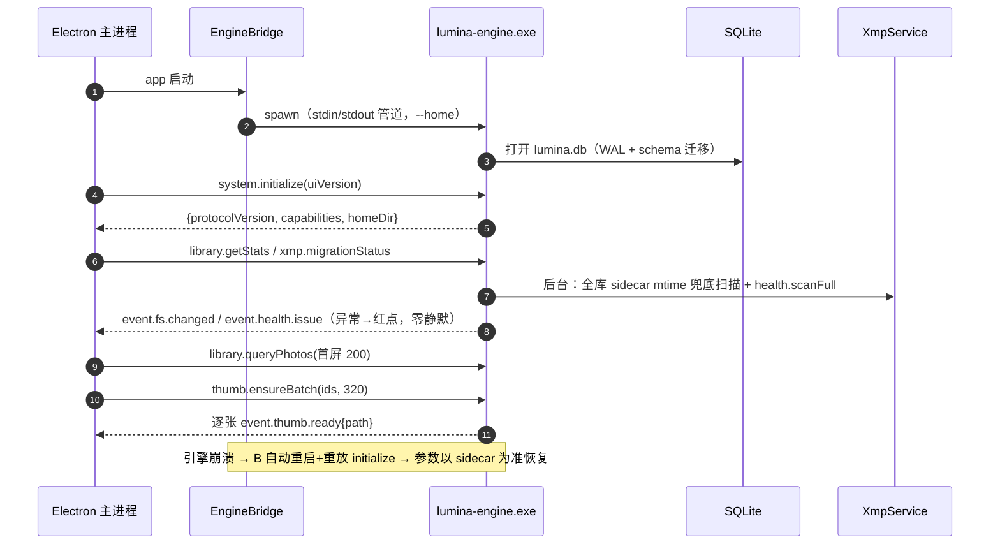
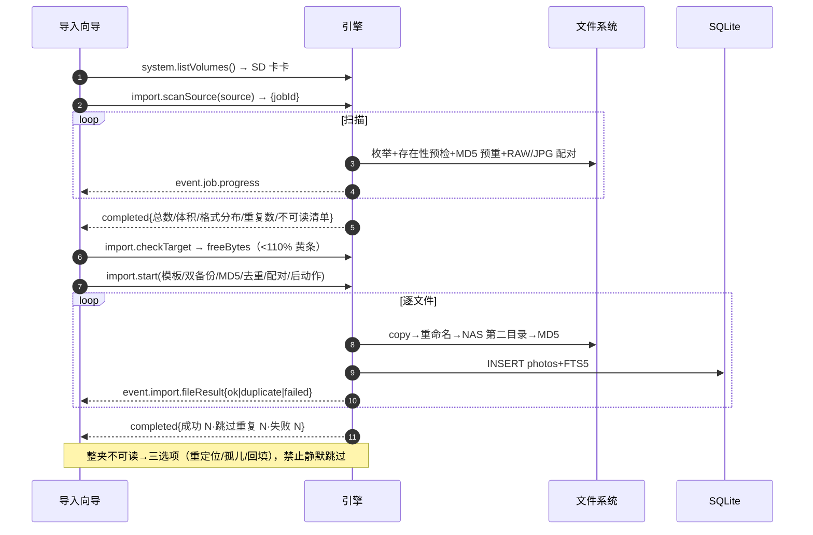
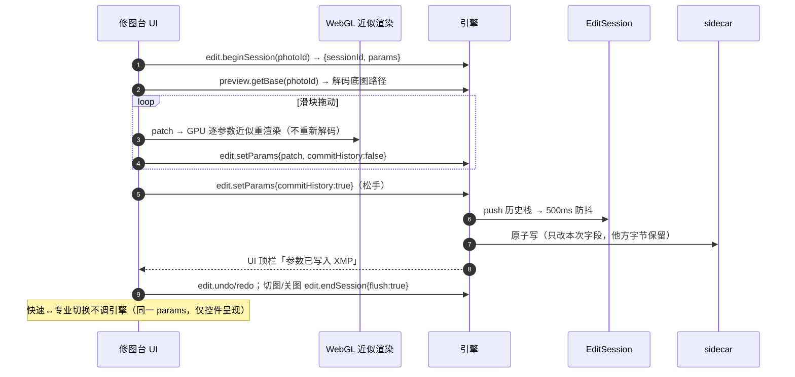
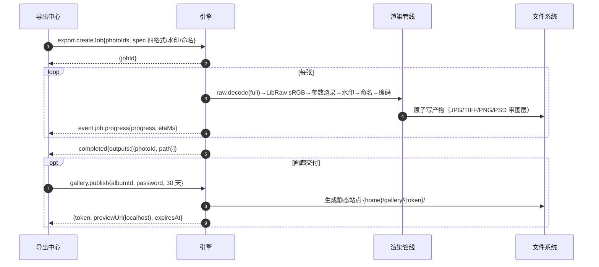
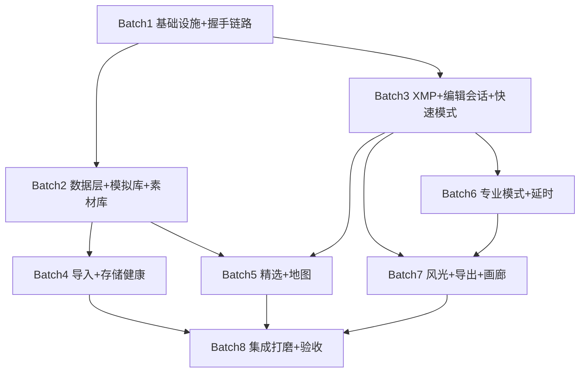

# LUMINA v1.0.0 · 系统架构设计与任务分解

> 架构师：高见远（Bob）· 2026-10-22 · 供工程师直接按此实现的蓝图
> 需求来源：`docs/PRD-LUMINA-v1.0.0.md`（**v1.0.1，范围冻结，唯一权威副本**）+ `LUMINA-1.0.0-范围与路线图.md` + M1 组件规格 + XMP 字段映射表 + design-tokens.css + 13 帧设计稿
> 实测基线已并入：LibRaw 0.21.4 静态库编译成功（EXIT=0）、SQLite FTS5 中文检索通过（`gcc` 编译 + `-D_WIN32_WINNT=0x0A00`）→ 见 §8 第 0 条「本机编译约定」与 §1.5「模拟资产与 L1/L2 验证强度」
> 配套契约：**`docs/ipc-protocol.md`（IPC 完整规范，引擎/UI 并行开发的唯一契约）**、`docs/sequence-diagram.mermaid`、`docs/class-diagram.mermaid`
> 环境已验证：MinGW-w64 g++ 8.1.0 / CMake 4.4.4 / Ninja 1.13.2 / Node 22.22.2 / npm 10.9.7；LibRaw 0.21.4 静态库已编好（`thirdparty/libraw/lib/libraw.a`）；SQLite 3.54.1 amalgamation 就位

---

## 1. 实现方案与框架选型

### 1.1 总体架构：双进程混合架构

```
┌────────────────────────────────────────────────────────────┐
│ Electron 应用                                                │
│  ┌──────────────┐   stdio JSON-RPC（4B 长度前缀帧）           │
│  │ 主进程        │◄──────────────────────────────────────►  │
│  │ EngineBridge │        lumina-engine.exe（C++17）          │
│  │ 看护/重启/超时 │   RPC层 · SQLite+FTS5 · LibRaw · XMP     │
│  ├──────────────┤   导入/健康/导出/延时/HDR/地图/画廊/模拟      │
│  │ 渲染进程 React│   文件产物一律走路径引用（缩略图/预览/导出）  │
│  │ Vite+TS+Tailwind（消费 design-tokens 双主题）               │
│  │ WebGL 参数近似渲染（修图台实时预览）                          │
│  └──────────────┘                                            │
└────────────────────────────────────────────────────────────┘
        │ file:// 路径加载二进制          │ 生成静态画廊站点
        ▼                                ▼
  {home}/cache/{thumbs,previews}   {home}/gallery/{token}/（localhost 预览）
```

**为什么独立进程 + stdio JSON-RPC**（PRD §8.1 已拍板，本文给落地理由）：
1. **故障隔离**：LibRaw 解码、HDR 合成、延时渲染都是崩溃高发区，进程边界保证引擎崩溃不拖垮 UI；看护重启后参数天然可恢复（一切以 sidecar 为准）。
2. **无 node-gyp 路线**：本机无 MSVC/vcpkg，原生插件不可行；独立进程用 g++ 直编，CMake+Ninja 完全可控。
3. **吞吐够用**：二进制不进 JSON（一律落盘传路径），JSON 帧只传元数据，单条 <8MiB 上限；出现大图往返 >50ms 瓶颈时再加共享内存通道，接口不变。
4. **可替换性**：未来换 Rust/Go 重写引擎，契约（ipc-protocol.md）不变。

### 1.2 核心技术难点与选型

| 难点 | 选型 | 理由 |
|---|---|---|
| RAW 解码（RW2 绝对优先） | **真 LibRaw 0.21.4 静态库**（已编好，EXIT=0）：对真实图库直解 RW2；本轮模拟资产用**结构合法的未压缩 Linear DNG** 走完 `open→unpack→demosaic(AHD)→dcraw_process→线性 RGB`，**验证强度 = L1** | 见 §1.5 专项决策；内嵌 JPEG 提取（DNG 内嵌预览）仅作 L2 兜底与代理渲染 |
| 全文检索 | **SQLite FTS5**（amalgamation 编译加 `-DSQLITE_ENABLE_FTS5`） | 单文件零依赖、WAL 模式支撑多读单写；18,192 行规模查询 <100ms 无压力 |
| XMP 字节级保留写 | **自研 XmpDocument**（带偏移量记录的轻量 DOM） | 红线 R1 要求「非本次编辑字段逐字节保留 + 保序保注释」——通用 XML 库重序列化做不到字节级保留；方案见 §4.1 |
| 缩略图/图像编码 | **stb_image / stb_image_write** | 单头文件、零依赖；缩略图生成/导出 JPG/PNG/TIFF 编码全覆盖 |
| 实时预览渲染 | **WebGL（UI 侧）参数近似管线** + 引擎全质量解码底图 | 引擎出解码底图（LibRaw→sRGB JPEG），UI 用 shader 逐参数近似（曝光/对比/曲线/WB…）；切换快速/专业模式零解码零闪黑；LCMS2 接入后近似管线上移引擎，结构不变 |
| 模拟影像资产 | **未压缩 Linear DNG（TIFF-EP 结构，16bit CFA）** + stb 写出的真 JPEG（伴随 JPG） | 见 §1.5：不伪造 RW2 容器（Panasonic MakeNote 构造成本高且易错），改用 LibRaw 支持成熟的 DNG，保证 L1 真实解码 |
| UI 框架 | **Electron + React 18 + TypeScript + Vite + Tailwind** | 路线图已定；Tailwind 直接引用 `--Lumina-Tokens-*` 变量，禁止硬编码色值（R5） |
| 虚拟滚动 | **react-window + 分页查询（页大小 200）** | 18,192 张网格滚动 ≥30fps 的最小实现；可视区 ±2 行预取 `thumb.ensureBatch` |
| 状态管理 | **zustand** | 轻量、无 boilerplate；job/通知流用全局 store 分发 |
| 延时视频编码 | **运行时探测 ffmpeg（PATH）→ H.264/H.265；不可达则 MJPEG AVI 替身（stb 编码）** | 见 §9 待明确 D1；ProRes 选项 UI 置灰 +「依赖待接入」，绝不产出坏文件（§9-Q3） |
| 地图底图 | **程序化暗色矢量底图（Canvas 自绘等高线风格）+ 真实墨卡托投影换算** | PRD §8.8；无网络依赖、合规零风险；坐标模型按真实投影设计，v1.1 换合规瓦片源 |
| Web 画廊 | 引擎生成**静态站点** → Electron 主进程起 localhost http 预览 | 不在 C++ 侧写网络服务器，WinSock 复杂度省掉；密码门禁为「本地预览级」（§9-Q4） |
| JSON 解析（引擎侧） | **自研最小 JSON 模块**（`engine/src/json/`） | nlohmann 单头需 GitHub 下载（不稳定）；协议 JSON 结构自控，自研 ~800 行可控可测；若日后网络可达可无缝替换 |

### 1.3 架构模式

- **引擎**：分层 —— `rpc/`（协议层）→ `Dispatcher`（编排层）→ 业务服务层（`library/ import/ health/ xmp/ edit/ export/ timelapse/ hdr/ denoise/ map/ gallery/ mock/`）→ 数据层（`db/` + 文件系统）。服务间只经 Dispatcher 与 DAO 交互，禁止横向直调（模块化、可独立发版）。
- **UI**：`app/src/modules/*` 按业务模块划分（对应 9 大模块一比一），共享层 = `api/`（协议镜像）+ `store/`（zustand）+ `components/` + `theme/`（令牌）+ `webgl/`。
- **并发模型**：引擎 = stdin 读线程（1）+ 主分发线程（1）+ 工作线程池（4，长任务）；SQLite WAL + `busy_timeout=5000`；per-photo XMP 写队列串行化；LibRaw 解码并发上限 2（内存约束）。

### 1.4 三条红线的架构落点

| 红线 | 架构保证 |
|---|---|
| R1 不锁库 | sidecar 是**唯一参数真相源**：会话内存参数只是缓存，500ms 防抖 + 强制 flush 落盘；`XmpDocument` 字节保留式写；原片路径只读打开 |
| R2 非破坏性 | 历史栈/快照/虚拟副本全部持久化于 sidecar（`lumina:Snapshot/VirtualCopyOf/AdjustmentStack`），引擎内存栈只是加速 |
| R3 完整性透明 | 引擎自动开启 ReadDirectoryChangesW 实时监测 + 启动兜底扫描，任何异常必发 `event.health.issue`/`event.fs.changed`；UI 端**禁止吞错**（组件规范写入共享知识 §8） |

### 1.5 模拟资产策略与 RAW 管线验证强度（L1 / L2）

> 背景：本轮无用户真实照片（PRD §8.4 / §9-Q10）。若模拟文件只是"改了扩展名的 JPEG"，LibRaw 无法 `open→unpack→dcraw_process`，核心卖点「真 RAW 管线」就退化成 L2（PRD 明确：只到 L2 必须在验收报告写明）。

**决策（架构层拍板）：模拟影像本体 = 结构合法的未压缩 Linear DNG，不伪造 RW2 容器。**

| 项 | 方案 |
|---|---|
| 为什么不伪造 RW2 | RW2 需 Panasonic MakeNote + 专用压缩格式（JPEG-from-raw / packed 12bit），构造成本极高且极易产出 LibRaw 打不开的畸形文件；**风险不可控** |
| DNG 结构的确定性 | DNG = TIFF-EP，LibRaw 对 DNG 支持成熟稳定。必须写入的最小标签集：`DNGVersion`(1.4.0.0) · `DNGBackwardVersion` · `ImageWidth/ImageLength` · `PhotometricInterpretation=32803(CFA)` · `CFAPattern=2(RGGB)` · `CFAPlaneColor=3` · `CFARepeatPatternDim=2,2` · `SamplesPerPixel=1` · `BitsPerSample=16` · `Compression=1`（未压缩） · `BlackLevel` · `WhiteLevel` · `Orientation` · `StripOffsets/StripByteCounts` · `RowsPerStrip` · `UniqueCameraModel` + `Make/Model` |
| Make/Model 取值 | `Make="LUMINA-MOCK"`、`UniqueCameraModel="LUMINA Mock S5M2"`。**不得写 `Panasonic`**，否则 LibRaw `identify()` 会按 Panasonic 解码器路由到 RW2 分支而失败（LibRaw 按内容识别而非扩展名） |
| 影像内容生成 | 程序化合成风光/建筑 RGB：天空渐变 + 山体剪影 + 雾层 + 建筑线条 + 噪声纹理（按题材分 5 类风格）→ 按 RGGB 采样降为单通道 CFA → 16bit 写入 Strip。LibRaw 解出后视觉上就是那张图，管线端到端可验证 |
| 内嵌预览（L2 兜底） | 同一 DNG 内嵌全尺寸/缩略 JPEG（DNG preview IFD），供 `raw.getProxy` 与代理优先渲染路径真实跑通（即使 DNG 路径被禁用也不至于无图） |
| 扩展名与索引口径 | 磁盘文件 = `.dng`（诚实反映内容）；DB `photos.format` = 磁盘真实格式（DNG/JPG/MP4/PNG/PSD）；**新增 `display_format` = 复刻真实基准的展示格式（RW2/DNG/ARW/JPG…）**，UI 徽标、筛选器「格式」维度、统计分布一律读 `display_format`，从而 92.2% RW2 的分布被真实复刻 |
| 声明义务 | `{home}` 与 `D:/Lumina/` 根目录生成 `README-MOCK.md`：「模拟资产为 Linear DNG，用于验证 RAW 管线；接真实图库时 LibRaw 直解 RW2 无需改动」 |
| 体积控制 | 默认资产 1200×800 16bit 未压缩 ≈1.9MB/张 → 18,192 张 ≈35GB（实测 D: 剩余 151GB，够用）。生成前校验目标盘空闲 ≥50GB，不足则自动降 `assetScale`（0.5 → 600×400 ≈9GB）并在结果中标注。索引层 `file_size` 仍按真实基准分布标注（~28MB）用于统计演示，磁盘实际体积以生成结果为准 |
| **L1 判定** | 生成后自动跑 `raw.selfTest`：**抽样 32 张**走 `LibRaw::open_file → unpack → dcraw_process → copy_mem_image`，要求 100% 成功且输出非空、非全黑（均值 ∈ [16, 240]）→ 记 `dngSelfTest:{ok:true, sampled, succeeded, decodeMsP50}`。**全部 L1 通过才允许标注「RAW 管线已真验证」** |
| **L2 降级** | 若 DNG 路径整体失败（链接或解码），降级为「仅内嵌 JPEG 可提取」，UI 保留「预览近似」标记，且**验收报告必须写明「RAW 管线验证强度 = L2」**，并把 L1 回归列入真实图库接入必测项（PRD §9-Q10） |

**模拟资产生成器 = 独立可复用模块**（`engine/src/mock/`，见 §2.1），一次调用产出：18,192 条元数据 + 影像文件 + 同分布 XMP sidecar + 421 条缺失标记。数据分布参数表见 §2.4。

---

## 2. 目录结构与文件清单

> 约定：`{home}` = 运行时数据目录，开发期默认 `D:/LUMINA/build/runtime/`（含 `lumina.db`、`cache/thumbs|previews|renders`、`gallery/`、`logs/`、`settings.json`），生产由 `--home` 参数覆盖。
> 构建产物：`build/engine/`（CMake out-of-tree）、`build/app/`（Vite dist）。`thirdparty/` **不改动**。

### 2.1 引擎 `engine/`（C++17）

| 文件 | 职责 |
|---|---|
| `engine/CMakeLists.txt` | 构建定义：C++17；`sqlite3.c` 单列为 **C 编译单元**（gcc + FTS5 开关），`.cpp` 为 C++ 单元；链接 libraw.a + stb；`-static-libgcc -static-libstdc++`（完整开关见 §7 / §8 第 0 条） |
| `engine/CMakeLists.txt`（toolchain 片段） | 显式指定 `CMAKE_C_COMPILER=gcc`、`CMAKE_CXX_COMPILER=g++`（MinGW 路径由 `scripts/env.ps1` 注入） |
| `engine/src/main.cpp` | 入口：解析 `--home`，初始化日志/配置/线程池/DB，进入 RpcServer 主循环，SIGINT 优雅退出 |
| `engine/src/rpc/version.h` | 协议版本常量（与 `app/src/api/protocol.ts` CI 对齐） |
| `engine/src/rpc/frame.h/.cpp` | 4 字节 LE 长度前缀帧编解码（8MiB 上限） |
| `engine/src/rpc/rpc_server.h/.cpp` | stdin 读取线程、响应/通知发送队列、stdout 互斥 |
| `engine/src/rpc/dispatcher.h/.cpp` | 方法注册表与分发、参数校验、错误码封装 |
| `engine/src/json/json_value.h/.cpp` | 自研 JSON 值对象 + 解析器 + 序列化器（协议专用） |
| `engine/src/core/config.h/.cpp` | `{home}` 目录布局、settings.json 读写、库根目录管理 |
| `engine/src/core/logger.h/.cpp` | 格式 `[时间][级别][线程][模块] msg`，stderr + 滚动文件 |
| `engine/src/core/thread_pool.h` | 固定 4 线程池（header-only） |
| `engine/src/core/job_manager.h/.cpp` | 异步任务：jobId 分配、取消标志、进度回调 → `event.job.*` 通知 |
| `engine/src/core/md5.h/.cpp` | MD5 实现（导入校验/存储健康共用） |
| `engine/src/core/str_util.h/.cpp` | 路径规范化（正斜杠）、UTF-8↔UTF-16（Win32 API 调用用）、时间格式化 |
| `engine/src/db/database.h/.cpp` | SQLite 打开（WAL）、`schema_version` 迁移框架、预编译语句缓存 |
| `engine/src/db/schema.sql` | 全库表结构（见 §4.3） |
| `engine/src/db/photo_dao.h/.cpp` | photos 表 CRUD、多维筛选查询、分页、facets、时间轴聚合、软删除/恢复 |
| `engine/src/db/fts_indexer.h/.cpp` | FTS5 索引写入与重建（文件名/地点/日期） |
| `engine/src/db/album_dao.h/.cpp` | 精选集/画册 CRUD + 排序持久化 |
| `engine/src/db/health_dao.h/.cpp` | 异常清单（缺失/损坏）CRUD、四状态聚合查询 |
| `engine/src/library/query_engine.h/.cpp` | 筛选条件 → SQL 的翻译器（AND 组合、chips 可移除的数据基础） |
| `engine/src/library/folder_tree.h/.cpp` | 5 根目录/79 文件夹树构建 |
| `engine/src/library/smart_collections.h/.cpp` | ≥6 条内置智能收藏夹规则定义与执行 |
| `engine/src/imaging/imaging.h/.cpp` | 缩放/JPEG/PNG 编码封装（供缩略图、导出、水印、画廊共用） |
| `engine/src/imaging/stb_impl.cpp` | stb 实现宏的唯一定义处（`STB_IMAGE_*_IMPLEMENTATION`） |
| `engine/src/thumb/thumbnail_service.h/.cpp` | 优先级队列生成（320/640 双档）、LRU 缓存（配额 5GB）、代理缺失时同步解码回填 |
| `engine/src/raw/raw_decoder.h/.cpp` | LibRaw 封装：解 RW2/DNG/ARW → sRGB 像素/JPEG 落盘、元数据提取 |
| `engine/src/raw/embedded_proxy.h/.cpp` | RW2 容器内嵌 JPEG 提取（fallback，版本回归覆盖） |
| `engine/src/metadata/exif_reader.h/.cpp` | JPEG APP1/TIFF IFD 最小 EXIF 解析（相机/镜头/GPS/拍摄时间） |
| `engine/src/metadata/video_probe.h/.cpp` | MP4/MOV 最小 box 扫描（时长/创建时间；v1.0 仅索引+缩略图，§9-Q2） |
| `engine/src/xmp/xmp_document.h/.cpp` | **字节保留式 XMP 编辑器**：解析时记录未触碰节点区间，序列化时逐字节拼接（R1 核心） |
| `engine/src/xmp/xmp_mapper.h/.cpp` | EditParams ↔ crs:/lumina: 双向映射（严格按 XMP 映射表 §1–§5）、lrt: 读入/回写通道 |
| `engine/src/xmp/xmp_service.h/.cpp` | 读写门面：mtime 外部修改检测（→1005）、temp+rename 原子写、per-photo 写队列 |
| `engine/src/xmp/migrator.h/.cpp` | SchemaVersion 启动扫描、静默迁移、ProcessVersion 超前提示（→1006） |
| `engine/src/edit/edit_session.h/.cpp` | 内存参数会话：revision、patch 合并、500ms 防抖定时器 |
| `engine/src/edit/history.h/.cpp` | 历史栈（undo/redo，持久化快照点） |
| `engine/src/edit/virtual_copy.h/.cpp` | 虚拟副本创建/列举（lumina:VirtualCopyOf） |
| `engine/src/import/scanner.h/.cpp` | 来源扫描：枚举、存在性预检、格式分布、RAW+JPG 配对、库内 MD5 比重 |
| `engine/src/import/importer.h/.cpp` | 导入执行 job：复制→重命名→双备份→MD5→入库，单文件失败不中断 |
| `engine/src/import/rename.h/.cpp` | 命名模板引擎（导入/导出共用：`YYYY-MM-DD_地点_序号`） |
| `engine/src/health/scanner.h/.cpp` | 全库扫描：存在性 + MD5 增量校验、断点续扫 |
| `engine/src/health/watcher.h/.cpp` | ReadDirectoryChangesW 实时监测（missing/restored/modified） |
| `engine/src/health/backup.h/.cpp` | 第二目录（NAS 替身）备份/恢复、状态记录 |
| `engine/src/export/exporter.h/.cpp` | 导出 job：解码→参数烧录→水印→命名→四格式编码（PSD 带图层写分层结构） |
| `engine/src/export/watermark.h/.cpp` | 水印合成（位置/大小/透明度） |
| `engine/src/timelapse/sequence_detector.h/.cpp` | RAW 序列自动成组（间隔+EV 规则） |
| `engine/src/timelapse/flicker_analyzer.h/.cpp` | 去闪分析（亮度统计 → 量化结果） |
| `engine/src/timelapse/exposure_ramp.h/.cpp` | Holy Grail 关键帧模型、曲线插值、lumina:ExposureRamp + lrt: 双写 |
| `engine/src/timelapse/renderer.h/.cpp` | 逐帧渲染 job（解码+参数烧录+Ramp 插值） |
| `engine/src/timelapse/encoder.h/.cpp` | 编码器探测（ffmpeg PATH）→ H.264/H.265；MJPEG AVI 替身；ProRes 探测置灰 |
| `engine/src/hdr/aligner.h/.cpp` | 包围组识别 + 金字塔粗对齐（基础版） |
| `engine/src/hdr/merger.h/.cpp` | 曝光合并 + 简单鬼影消除（亮度一致性投票） |
| `engine/src/denoise/nlm.h/.cpp` | 非局部均值降噪 + 亮度蒙版加权（tile 并行） |
| `engine/src/map/geo_index.h/.cpp` | 地点表 + 按 zoom 的网格聚合（cluster/展开）、未定位清单 |
| `engine/src/gallery/site_generator.h/.cpp` | 静态画廊站点生成（hero/计数条/筛选/收藏标记/交付下载区/密码门禁） |
| `engine/src/mock/generator.h/.cpp` | 模拟图库生成器编排：目录树→元数据→影像→sidecar→缺失标记，全流程 job 化（进度可查） |
| `engine/src/mock/distribution.h/.cpp` | 数据分布参数表（§2.4）与按分布的伪随机抽样（可复现 seed） |
| `engine/src/mock/image_synth.h/.cpp` | 程序化影像合成：天空渐变/山体剪影/雾/建筑线条/噪声，5 类题材风格 |
| `engine/src/mock/dng_writer.h/.cpp` | **未压缩 Linear DNG 写入器**（TIFF-EP：IFD0+SubIFD+CFA 标签集+16bit Strip+内嵌 JPEG 预览），见 §1.5 |
| `engine/src/mock/sidecar_synth.h/.cpp` | 同分布 XMP sidecar 生成（crs: 全字段 + 局部蒙版 83.8% + lrt: 延时组 + lumina: 扩展） |
| `engine/tests/test_xmp_roundtrip.cpp` | M1 出口五用例：存量解析/幂等/不污染/外部修改检测/迁移器 |
| `engine/tests/test_rpc_smoke.cpp` | 协议冒烟： initialize→query→thumb→shutdown 全链路 |
| `engine/tests/test_query_perf.cpp` | 18,192 行负载下 query/search 计时断言（<100ms） |

### 2.2 UI `app/`（Electron + TS + React）

| 文件 | 职责 |
|---|---|
| `app/package.json` / `tsconfig.json` / `vite.config.ts` / `tailwind.config.ts` / `postcss.config.js` / `index.html` | 工程配置（Tailwind 颜色全部映射 `--Lumina-Tokens-*`） |
| `app/electron/main.ts` | 主进程：窗口、生命周期、spawn 引擎（EngineBridge）、localhost 画廊预览服务器、`--home` 透传 |
| `app/electron/engine-bridge.ts` | 引擎子进程管理：帧编解码、请求超时/取消、**崩溃看护自动重启 + initialize 重放** |
| `app/electron/preload.ts` | contextBridge 暴露 `window.lumina`（类型化 RPC + 事件订阅） |
| `app/src/main.tsx` / `App.tsx` | 入口、模块路由（9 模块 + 空库引导）、主题切换（`data-theme`） |
| `app/src/theme/tokens.css` | design-tokens.css 的引入副本（单一来源，浅色 `[data-theme="Light"]`） |
| `app/src/theme/ThemeProvider.tsx` | 主题状态、viewer 区恒色封装（`<ViewerSurface>`，R5） |
| `app/src/api/protocol.ts` | ipc-protocol.md 的 **TS 镜像类型**（PhotoSummary/Filter/EditParams/JobInfo…） |
| `app/src/api/rpc-client.ts` | 请求/通知分发、超时（10s）、job 事件总线 |
| `app/src/api/hooks.ts` | `useQuery/useThumb/useJobProgress` 等 React 绑定 |
| `app/src/store/jobStore.ts` / `libraryStore.ts` / `developStore.ts` | 全局任务、图库筛选/选择、修图会话状态 |
| `app/src/modules/library/*` | LibraryPage、GridVirtual（react-window）、GridItem（徽标体系）、Filmstrip、SidebarFolderTree、SmartCollections、FilterPanel（chips）、SearchBar（200ms 防抖）、TimelineBar、PhotoInspector |
| `app/src/modules/ingest/*` | IngestWizard 三步（SourceCard/SummaryCard/TargetStep/OptionsStep）、ExecutingBar（速率/ETA/失败清单）、MissingFolderDialog（三选项） |
| `app/src/modules/develop/*` | DevelopPage、ModeSwitch（快速/专业，共享参数零切换成本）、ViewerCanvas、BeforeAfterSlider、panels/FastPanel（预设+6滑块+曲线）、panels/ProPanel（图层栈/混色器/颜色分级/细节/光学/校准/变换/范围蒙版）、panels/MaskPanel、panels/HistogramPanel、panels/HistoryPanel |
| `app/src/modules/develop/webgl/renderer.ts` / `shaders.ts` | 参数近似渲染管线（曝光/对比/曲线/WB/HSL/锐化/暗角/颗粒逐项 shader） |
| `app/src/modules/culling/*` | CullingPage（键盘流 X/P/U/0-5/Enter/F/Caps）、AutoPromotionRule、CullBatchBar（三批量操作） |
| `app/src/modules/map/*` | MapPage、BasemapCanvas（程序化暗色底图+墨卡托）、LocationList、LocationDetailCard、DropPinHandler（GPS 反写） |
| `app/src/modules/timelapse/*` | TimelapsePage、SequenceList、FramePlayer（帧级拖动）、FlickerPanel、ExposureRampEditor（关键帧表+可拖曲线）、RenderQueuePanel（编码降级置灰） |
| `app/src/modules/landscape/*` | LandscapePage、HdrPanel（包围组合成）、DenoisePanel（前后对比）、v1.1/v1.2 禁用卡（版本 chip） |
| `app/src/modules/export/*` | ExportPage（四格式/水印/命名模板）、ExportQueuePanel、PortfolioPage（画册/排序/封面） |
| `app/src/modules/gallery/*` | GalleryPublishDialog、GalleryPreview、FeedbackPanel（收藏回传统计） |
| `app/src/modules/health/*` | HealthPage（四状态大数字行）、IssueList（三操作）、QuarantineView（隔离+备份恢复）、承诺区（显式告知文案） |
| `app/src/components/*` | Button/Slider/Chip/Dialog/Toast（5s 撤销）/KeycapBar/EmptyState/IconSet |
| `app/gallery-template/` | 静态画廊模板（index.html/style.css/app.js——引擎侧填充数据用） |

### 2.3 其他

| 文件 | 职责 |
|---|---|
| `scripts/env.ps1` | 工具链 PATH（g++/cmake/ninja/node）统一设定 |
| `scripts/build-engine.ps1` | 一键引擎构建（见 §6 Batch1 DoD 内命令） |
| `scripts/dev.ps1` | 并行启动 vite dev + electron（开发模式） |
| `scripts/smoke.ps1` | 向引擎 stdin 灌 JSON-RPC 帧序列做冒烟验收 |
| `docs/架构设计-LUMINA-v1.0.0.md` / `docs/ipc-protocol.md` / `docs/sequence-diagram.mermaid` / `docs/class-diagram.mermaid` / `docs/PRD-LUMINA-v1.0.0.md` | 本设计产出 |
| `thirdparty/` | **只读**：libraw（静态库+头）、sqlite amalgamation、stb_* |
| `build/engine/` `build/app/` `build/runtime/` | 构建产物与运行时数据（gitignore） |

### 2.4 模拟图库数据分布参数表（`mock.generate` 默认 spec）

| 维度 | 参数 | 默认值 |
|---|---|---|
| 总量 | `total` | 18,192 |
| 显示格式分布 | `displayFormat` | RW2 16,470 · JPG 1,387 · DNG 273 · ARW 15 · 视频(MP4) 45 · PSD 1 · PNG 1 |
| 根目录/文件夹 | `rootCount` / `folderCount` | 5 / 79（按日期 2025-12 → 2026-08，9 个月） |
| 相机 | `cameras` | Panasonic DC-S5M2 92.2%；其余 Sony/Canon（复刻真实分布） |
| 镜头 | `lenses` | LUMIX S 70-300 / S 24-60 / Sigma 20-200 / MJ / FE 70-200 / VILTROX 16（MJ 原样串不猜测） |
| 已调整 | `edited` / `maskRatio` / `removal` / `aiMask` | 4,347 / 83.8%（3,639）/ 58 / 183 |
| 评分 | `rating` | 2★ 1,365 · 3★ 1 · 4★ 57 · 5★ 0（覆盖率 7.8%） |
| GPS | `gpsCount` | 137（0.75%） |
| 白平衡 | `whiteBalance` | As Shot 14,310 / Custom 3,861 |
| 缺失 | `missing` | 421（RW2 417 + MP4 4，集中 7 个文件夹） |
| 延时组 | `lrtGroups` | 松赞林寺 198 · 雾浓顶 662（sidecar 含 lrt: 结构） |
| 影像资产 | `assetFormat` / `assetWidth` / `assetHeight` / `assetScale` | `linear-dng` / 1200 / 800 / 1.0（约 35GB；空闲 <50GB 自动降至 0.5） |
| 可复现性 | `seed` | 20261022（固定 seed → 每次生成分布一致，便于回归） |

---

## 3. IPC 协议规范（摘要；完整契约见 `docs/ipc-protocol.md`）

**帧**：stdio，4 字节小端长度前缀 + UTF-8 JSON 载荷，单帧 ≤8MiB；stdout 仅协议、日志走 stderr/文件。**二进制一律落盘传路径**。

**信封**：JSON-RPC 2.0；UI→引擎请求，引擎→UI 通知（`event.*`）；错误码 24 个（标准 5 + 业务 1001–6001，关键：1005 XMP 外部修改冲突、1006 Schema 过新、4002 MD5 不符、5001 编码器不可达）。

**方法总表（约 95 个，15 域）**：

| 域 | 方法数 | 代表方法 |
|---|---|---|
| 系统握手 | 6 | `system.initialize/shutdown/ping/getSettings/setSettings/listVolumes` |
| 图库查询 | 12 | `library.queryPhotos`（Filter+Sort+Page）、`library.search`（FTS5）、`getFacets/getTimeline/getFolderTree/getPhotoDetail/updatePhotos/removePhotos+restore`（5s 撤销）、智能收藏夹 2 |
| 相册 | 5 | `albums.list/create/addPhotos/removePhotos/reorder` |
| 缩略图预览 | 4 | `thumb.ensureBatch`+`event.thumb.ready`、`preview.getBase`（libraw/embedded-jpeg 来源标注）、`cache.clear` |
| XMP | 5 | `xmp.read/write`（原子写、1005 冲突）、`checkExternal/listNamespaces/migrationStatus` |
| 编辑会话 | 12 | `edit.begin/setParams/undo/redo/endSession`（引擎 500ms 防抖落盘）、快照 3、虚拟副本 2、预设 2 |
| 同步序列 | 2 | `edit.syncToSelection/syncToSequence` |
| RAW 渲染 | 5 | `raw.decode`（真 LibRaw，>2s 转 job）、`raw.getProxy`（内嵌 JPEG 兜底）、`raw.selfTest`（**L1 判定**：抽样 32 张走 open→unpack→dcraw_process）、`analysis.histogram` |
| 导入 | 6 | `import.scanSource/checkTarget/start/cancel/resolveMissingFolder（三选项）/listRecentSources` |
| 存储健康 | 7 | `health.getStatus（四状态）/scanFull/listIssues/resolveIssue/restoreFromBackup/verifyPhotos/getBackupConfig` |
| 导出 | 6 | `export.createJob`（JPG/TIFF/PNG/PSD 带图层+水印+命名）、队列管理 4 |
| 延时 | 8 | `timelapse.list/getSequence/analyzeFlicker/applyDeflicker/setExposureRamp/previewFrame/render/getRenderJobs` |
| 风光专项 | 4 | `hdr.detectBracketGroups/composite`、`denoise.apply/preview` |
| 地图 | 6 | `map.getLocations`（zoom 聚合）、`setPhotoLocation`（**写 sidecar exif: 命名空间**）、未定位清单、收藏 |
| 画廊 | 5 | `gallery.publish（30 天+密码）/revoke/listPublished/importFeedback/getFeedback` |
| 模拟图库 | 2 | `mock.generate`（18,192 条元数据 + Linear DNG 影像 + 同分布 sidecar + 421 缺失；结果含 `dngSelfTest` L1 判定）/`mock.status` |

**事件 7 个**：`event.job.progress/completed`、`event.thumb.ready`、`event.fs.changed`、`event.health.issue`、`event.import.fileResult`、`event.engine.log`。

字段级 schema（请求/返回/错误 data）全部在 `docs/ipc-protocol.md` §5，双方以该文件为唯一契约，CI 校验 `rpc/version.h` 与 `api/protocol.ts` 版本常量一致。

---

## 4. 数据结构与接口

### 4.1 C++ 核心类图

```mermaid
classDiagram
    direction TB

    class RpcServer {
        -FILE* stdin
        -FILE* stdout
        +run() int
        +sendNotification(method, paramsJson)
        +sendResponse(id, resultJson)
        +sendError(id, code, msg, dataJson)
    }
    class Dispatcher {
        -map~string,Handler~ handlers_
        +registerMethod(name, handler)
        +dispatch(request) Response
    }
    class FrameCodec {
        +encode(payload) bytes$
        +decode(buffer) Frame$
    }
    class JsonValue {
        +parse(text) JsonValue$
        +serialize() string
    }
    RpcServer *-- FrameCodec
    RpcServer --> Dispatcher
    Dispatcher --> JsonValue

    class ThreadPool {
        -vector~thread~ workers_
        +submit(task) future
    }
    class JobManager {
        -map~int64,Job~ jobs_
        +start(kind, task) jobId
        +cancel(jobId) bool
        +progress(jobId, pct, detail)
    }
    class Config {
        +homeDir Path
        +libraryRoots vector~Path~
        +backupTarget Path
        +load() +save()
    }
    class Logger {
        +info(warn,error)(module, msg)
    }
    JobManager --> ThreadPool
    JobManager --> RpcServer : 进度/完成通知

    class Database {
        -sqlite3* db_
        +open(path) +migrate()
        +prepare(sql) Stmt
    }
    class PhotoDao {
        +query(filter, sort, page) QueryResult
        +search(text, page) QueryResult
        +getById(id) PhotoRecord
        +upsert(record) int64
        +updateFlags(ids, patch)
        +softRemove(ids) +restore(ids)
        +facets(filter) FacetResult
        +timeline(filter) vector~MonthBucket~
    }
    class FtsIndexer {
        +indexPhoto(photo)
        +rebuildAll()
    }
    class AlbumDao {
        +list(kind) +create(name,kind)
        +addPhotos +removePhotos +reorder
    }
    class HealthDao {
        +upsertIssue(issue) +listIssues(kind,page)
        +resolve(issueId, action) +counts() HealthCounts
    }
    Database --> PhotoDao
    Database --> AlbumDao
    Database --> HealthDao
    PhotoDao --> FtsIndexer

    class XmpDocument {
        -string rawPacket
        -vector~Span~ untouchedSpans_
        +parse(bytes) XmpDocument$
        +setField(ns, name, value)
        +getField(ns, name) optional~string~
        +serialize() bytes
    }
    class XmpMapper {
        +toParams(doc) EditParams$
        +applyParams(doc, params)
        +readExposureRamp(doc) ExposureRamp
    }
    class XmpService {
        -map~int64,mtimes~ knownMtimes_
        -writeQueue per-photo
        +read(photoId) ReadResult
        +write(photoId, params) Mtime
        +checkExternal(photoId) bool
    }
    class ExifReader {
        +readJpegExif(path) ExifData$
        +extractGps(path) GeoPoint$
    }
    class Migrator {
        +scanDistribution() map
        +migrate(photoId) bool
    }
    XmpService --> XmpDocument
    XmpService --> XmpMapper
    XmpService --> Migrator

    class RawDecoder {
        -libraw_data_t ctx
        +decode(path, scale) DecodeResult$
        +readMetadata(path) RawMeta$
    }
    class EmbeddedProxy {
        +extract(path) JpegBytes$
    }
    class ThumbnailService {
        -LRUCache cache
        +ensureBatch(ids, size)
        +generate(photo) Path
    }
    class Imaging {
        +resize +encodeJpeg +encodePng
        +histogram(pixels) Histogram$
    }
    RawDecoder --> Imaging
    ThumbnailService --> RawDecoder : 代理缺失时同步解码
    ThumbnailService --> EmbeddedProxy
    ThumbnailService --> Imaging

    class EditSession {
        -int64 sessionId
        -EditParams params
        -int revision
        -HistoryStack history
        +applyPatch(patch, commitHistory) Params
        +undo() +redo() +flush()
    }
    class SessionManager {
        -map~int64,EditSession~ sessions_
        +begin(photoId) sessionId
        +end(sessionId, flush)
    }
    class VirtualCopyService {
        +create(photoId, name) vcopyId
        +list(photoId)
    }
    SessionManager --> EditSession
    SessionManager --> XmpService : 500ms 防抖落盘

    class ImportService {
        +scanSource(source) jobId
        +checkTarget(target, bytes)
        +start(options) jobId
        +resolveMissingFolder(path, action)
    }
    class HealthService {
        +scanFull() jobId
        +verifyPhotos(ids) jobId
        +restoreFromBackup(photoId) jobId
        -Watcher watcher
    }
    class ExportService {
        +createJob(photoIds, spec) jobId
        -burnParams(pixels, params)
        -applyWatermark() -applyNaming()
    }
    class TimelapseService {
        +listSequences() +getSequence(seqId)
        +analyzeFlicker(seqId) jobId
        +setExposureRamp(seqId, keyframes)
        +render(seqId, spec) jobId
    }
    class HdrService {
        +detectBracketGroups(filter)
        +composite(groupId, opts) jobId
    }
    class DenoiseService {
        +apply(photoId, strength, mask) jobId
        +preview(photoId, strength, rect) Path
    }
    class MapService {
        +getLocations(viewport, zoom) ClusterList$
        +setPhotoLocation(ids, geo)
        +toggleFavorite(locationId, fav)
    }
    class GalleryService {
        +publish(albumId, password, days) PublishResult
        +revoke(albumId) +importFeedback(albumId, path)
        -generateStaticSite()
    }
    class MockGenerator {
        +generate(spec) jobId
        +status() MockStatus
        -runSelfTest() SelfTestResult  %% L1 判定
    }
    class ImageSynth {
        +render(style, w, h) RgbBuffer$
    }
    class DngWriter {
        +write(path, cfa16, w, h, exif, previewJpeg)  %% TIFF-EP + CFA 16bit + 内嵌 JPEG
    }
    class SidecarSynth {
        +build(photoSeed) XmpBytes$
    }
    MockGenerator --> ImageSynth
    MockGenerator --> DngWriter
    MockGenerator --> SidecarSynth
    MockGenerator --> RawDecoder : selfTest
    class LibraryQuery {
        +queryPhotos(filter, sort, page)
        +folderTree() +timeline(filter)
        +smartCollections()
    }
    LibraryQuery --> PhotoDao
    LibraryQuery --> AlbumDao
    ImportService --> PhotoDao
    ImportService --> XmpService
    ImportService --> HealthService
    HealthService --> HealthDao
    ExportService --> RawDecoder
    ExportService --> Imaging
    ExportService --> XmpService
    TimelapseService --> XmpService
    TimelapseService --> RawDecoder
    HdrService --> RawDecoder
    DenoiseService --> RawDecoder
    MapService --> XmpService : GPS 反写 sidecar
    GalleryService --> AlbumDao
    MockGenerator --> PhotoDao
    MockGenerator --> XmpService

    Dispatcher --> LibraryQuery
    Dispatcher --> ThumbnailService
    Dispatcher --> XmpService
    Dispatcher --> SessionManager
    Dispatcher --> ImportService
    Dispatcher --> HealthService
    Dispatcher --> ExportService
    Dispatcher --> TimelapseService
    Dispatcher --> HdrService
    Dispatcher --> DenoiseService
    Dispatcher --> MapService
    Dispatcher --> GalleryService
    Dispatcher --> MockGenerator
    Dispatcher --> Config
    Dispatcher --> JobManager
```



**`XmpDocument` 字节保留算法**（R1 核心，单独说明）：解析时对 XMP 包建立节点树，**每个节点记录其在原始字节流中的 `[start, end)` 区间**；`setField` 只修改目标节点并新建区间；`serialize()` = 按原顺序拼接「未触碰节点原始字节 + 被改节点新字节」。未知命名空间节点永远是未触碰节点 → 逐字节吐回；注释与属性顺序天然保留。配套五个回归用例（`engine/tests/test_xmp_roundtrip.cpp`）= XMP 映射表 §9 的 M1 出口必测。

### 4.2 TS 核心类型（摘录；完整见 `app/src/api/protocol.ts` 镜像）

```typescript
// —— 与 ipc-protocol.md §4 一致 ——
type PhotoFormat = 'RW2' | 'JPG' | 'DNG' | 'ARW' | 'MP4' | 'PSD' | 'PNG';
type PickFlag = 'pick' | 'reject' | 'none';

interface PhotoSummary {
  id: number; fileName: string; filePath: string;
  format: PhotoFormat; width: number; height: number;
  capturedAt: number; importedAt: number;
  camera: string; lens: string; iso: number;
  aperture: string; shutter: string; focalLength: string;
  gpsLat: number | null; gpsLng: number | null;
  rating: 0 | 1 | 2 | 3 | 4 | 5; pick: PickFlag; colorLabel: string | null;
  hasEdits: boolean; hasGps: boolean; isMissing: boolean; isVideo: boolean;
  pairKind: 'raw+jpg' | 'single';
  thumbState: 'ready' | 'pending' | 'failed'; thumbPath: string | null;
  seqId: number | null;
}

interface Filter {
  folderIds?: number[]; rootIds?: number[];
  formats?: PhotoFormat[]; cameras?: string[]; lenses?: string[];
  minRating?: 1 | 2 | 3 | 4 | 5; pick?: PickFlag;
  located?: boolean; edited?: boolean; missing?: boolean; isVideo?: boolean;
  dateFrom?: number; dateTo?: number; locationIds?: number[]; seqId?: number;
}

interface MaskLayer {
  id: string;
  type: 'linear' | 'radial' | 'brush' | 'aiSky' | 'aiSubject' | 'aiBackground'
      | 'luminanceRange' | 'colorRange' | 'depth';
  enabled: boolean; opacity: number; amount: number;
  geometry?: { x1: number; y1: number; x2: number; y2: number }
          | { cx: number; cy: number; radius: number; ratio: number };
  strokes?: { x: number; y: number; radius: number; flow: number; density: number; erase: boolean }[];
  range?: { low: number; high: number; samples: number[] };
  local: { exposure: number; contrast: number; highlights: number; shadows: number;
           temperature: number; tint: number; saturation: number; clarity: number; dehaze: number };
}

interface AdjustmentLayer {   // lumina:AdjustmentStack
  id: string; name: string; kind: string; enabled: boolean;
  blendMode: 'normal' | 'multiply' | 'screen' | 'overlay' | string;
  opacity: number; params: Partial<EditParams>;
}

interface EditParams { /* 全字段见 ipc-protocol.md §4，映射 crs: 见 XMP 映射表 §1–§5 */
  processVersion: '15.4';
  whiteBalance: 'asShot' | 'custom'; temperature?: number; tint?: number;
  exposure: number; contrast: number; highlights: number; shadows: number;
  whites: number; blacks: number; clarity: number; texture: number; dehaze: number;
  vibrance: number; saturation: number;
  toneCurveRGB: { x: number; y: number }[];
  hsl: Record<'red'|'yellow'|'green'|'aqua'|'blue'|'purple'|'magenta', { hue: number; sat: number; lum: number }>;
  masks: MaskLayer[]; removals?: RemovalArea[]; adjustmentStack?: AdjustmentLayer[];
  /* …detail/optics/geometry/colorGrade/calibration 同协议文件 */
}

interface JobInfo { jobId: number; kind: string;
  state: 'queued' | 'running' | 'done' | 'failed' | 'cancelled';
  progress: number; detail: string; etaMs: number | null; }
```

### 4.3 SQLite Schema（`engine/src/db/schema.sql` 摘要）

```sql
PRAGMA journal_mode=WAL; PRAGMA busy_timeout=5000;
CREATE TABLE schema_meta(key TEXT PRIMARY KEY, value TEXT);          -- db_version=1

CREATE TABLE roots(id INTEGER PRIMARY KEY, path TEXT UNIQUE, label TEXT);
CREATE TABLE folders(id INTEGER PRIMARY KEY, root_id INT, rel_path TEXT, missing INT DEFAULT 0,
                     UNIQUE(root_id, rel_path));
CREATE TABLE photos(
  id INTEGER PRIMARY KEY, folder_id INT REFERENCES folders(id),
  file_name TEXT NOT NULL, file_path TEXT UNIQUE NOT NULL,
  format TEXT,        -- 磁盘真实格式：DNG/JPG/MP4/PNG/PSD（LibRaw 按此选解码器）
  display_format TEXT,-- 复刻基准的展示格式：RW2/DNG/ARW/JPG…（UI 徽标/筛选/统计用）
  file_size INT, md5 TEXT,
  width INT, height INT, captured_at INT, imported_at INT,
  camera TEXT, lens TEXT, iso INT, aperture TEXT, shutter TEXT, focal_length TEXT,
  white_balance TEXT, gps_lat REAL, gps_lng REAL, gps_alt REAL, location_id INT,
  rating INT DEFAULT 0, pick TEXT DEFAULT 'none', color_label TEXT, keywords TEXT, description TEXT,
  sidecar_path TEXT, sidecar_mtime INT, has_edits INT DEFAULT 0,
  is_missing INT DEFAULT 0, is_video INT DEFAULT 0, pair_kind TEXT DEFAULT 'single',
  health TEXT DEFAULT 'unchecked', deleted INT DEFAULT 0, seq_id INT);
CREATE INDEX idx_photos_captured ON photos(captured_at) WHERE deleted=0;
CREATE INDEX idx_photos_folder   ON photos(folder_id);
CREATE INDEX idx_photos_rating   ON photos(rating);
CREATE INDEX idx_photos_seq      ON photos(seq_id);
CREATE VIRTUAL TABLE photos_fts USING fts5(file_name, location, date, content='photos',
                     content_rowid='id', tokenize='unicode61');

CREATE TABLE locations(id INTEGER PRIMARY KEY, name TEXT, lat REAL, lng REAL, alt REAL,
                       favorite INT DEFAULT 0);
CREATE TABLE sequences(id INTEGER PRIMARY KEY, name TEXT, kind TEXT, frame_count INT);
CREATE TABLE sequence_frames(seq_id INT, frame_no INT, photo_id INT, PRIMARY KEY(seq_id, frame_no));
CREATE TABLE albums(id INTEGER PRIMARY KEY, name TEXT, kind TEXT, cover_photo_id INT,
                    published_token TEXT, published_at INT, expires_at INT);
CREATE TABLE album_items(album_id INT, photo_id INT, position INT, PRIMARY KEY(album_id, photo_id));
CREATE TABLE presets(id INTEGER PRIMARY KEY, name TEXT UNIQUE, params_json TEXT);
CREATE TABLE export_presets(id INTEGER PRIMARY KEY, name TEXT, spec_json TEXT);
CREATE TABLE health_issues(id INTEGER PRIMARY KEY, photo_id INT, kind TEXT, path TEXT,
                           last_known TEXT, status TEXT, detected_at INT);
CREATE TABLE jobs(id INTEGER PRIMARY KEY, kind TEXT, state TEXT, progress INT, detail TEXT);
```

---

## 5. 程序调用流程

四张关键时序图（启动握手 / 导入 / 参数变更→重渲染 / 导出）如下，源文件 `docs/sequence-diagram.mermaid`。

### 5.1 启动与握手



### 5.2 导入流程



### 5.3 修图参数变更 → 重渲染



### 5.4 导出流程



---

## 6. 有序任务列表（按依赖分 8 批）

> 粒度 = 工程师一次可完成的一批文件（每批 ≥3 文件）；每批给出**完成定义（DoD）**。深色主题贯穿全程，浅色随 Batch 8（§9-Q8）。

### Batch 1 · 工程基础设施（含端到端最小链路）　P0
**文件**：`engine/CMakeLists.txt`、`engine/src/main.cpp`、`rpc/*`（version/frame/rpc_server/dispatcher）、`json/*`、`core/*`（config/logger/thread_pool/job_manager/md5/str_util）、`app/` 全部工程配置 + `electron/*`、`src/main.tsx/App.tsx/theme/*`、`api/protocol.ts/rpc-client.ts`、`scripts/env.ps1/build-engine.ps1/dev.ps1/smoke.ps1`
**DoD**：
- `pwsh scripts/build-engine.ps1` 一键成功，命令等价于：
  `cmake -S engine -B build/engine -G Ninja -DCMAKE_BUILD_TYPE=Release "-DCMAKE_CXX_FLAGS=-std=c++17 -O2 -static-libgcc -static-libstdc++" && cmake --build build/engine`
- **必须遵守本机编译约定（§8 第 0 条）**：`sqlite3.c` 走 **gcc** 编译单元（`-DSQLITE_ENABLE_FTS5 -DSQLITE_ENABLE_FTS5_UNICODE61 -D_WIN32_WINNT=0x0A00`），C++ 源码走 g++，最后统一链接；LibRaw 静态库 `-L thirdparty/libraw/lib -lraw -lws2_32 -lm -lstdc++`，头文件 `-I thirdparty/libraw`
- 链接无符号缺失；`lumina-engine.exe` 可启动并完成 `system.initialize`
- UI 点击按钮 → `system.initialize` 握手成功，界面显示引擎版本；`scripts/smoke.ps1` 冒烟通过
- 崩溃看护：手动 kill 引擎 → UI 3s 内自动重启恢复

### Batch 2 · 数据层 + 模拟图库 + 素材库浏览　P0
**文件**：`db/*`（database/schema/photo_dao/fts_indexer/album_dao/health_dao）、`library/*`、`thumb/*`、`imaging/*`、`raw/raw_decoder+embedded_proxy`（含 `raw.selfTest`）、`metadata/*`、`mock/*`（generator/distribution/image_synth/dng_writer/sidecar_synth）、UI `modules/library/*` 全部 + `store/libraryStore` + `components/*`
**DoD**：
- `mock.generate` 生成 18,192 条（显示格式 RW2 16,470 等全分布 / 5 根目录 79 文件夹 / 421 缺失 / 已调整 4,347 含蒙版 83.8% / GPS 137 / 评分 2★1,365·3★1·4★57），**影像本体为结构合法未压缩 Linear DNG + 内嵌 JPEG 预览**（§1.5），根目录生成 `README-MOCK.md` 声明
- **L1 断言**：`raw.selfTest` 抽样 32 张 DNG 100% 走通 `open→unpack→demosaic(AHD)→dcraw_process` 且输出非空非全黑 → 结果写入 `mock.generate` 的 `dngSelfTest`；**未达 L1 必须按 §1.5 走 L2 并在报告标注**
- 网格虚拟滚动 18,192 张 ≥30fps、空白 ≤1 行；缩略图 120–320px 连续缩放
- 文件夹树+时间线默认视图、多维 AND 筛选 chips、搜索（200ms 防抖）<100ms、智能收藏夹 ≥6 条
- 网格徽标体系（RW2/编辑点/GPS/评分星/选中环/淘汰态）与 01 帧一致

### Batch 3 · XMP + 编辑会话 + 修图台快速模式　P0（红线主战场）
**文件**：`xmp/*`（xmp_document/xmp_mapper/xmp_service/migrator）、`edit/*`、`analysis`、UI `modules/develop/*`（快速模式部分）+ `webgl/*` + `store/developStore`
**DoD**：
- `test_xmp_roundtrip` 五用例全绿（存量解析/幂等/不污染 lrt:/外部修改检测/迁移器）
- 快速模式：预设 5+ 款一键套用、基本 6 滑块实时预览、色调曲线、渐变/径向/画笔三件套
- 参数 500ms 防抖写 XMP 且指示灯正确；快速↔专业切换零解码零闪黑
- 历史 undo/redo、快照、虚拟副本互不影响（R2 三验证）
- 同步到所选/序列生效，胶片条显示「N 张已同步」

### Batch 4 · 导入向导 + 存储健康　P0（红线 R3 主战场）
**文件**：`import/*`、`health/*`（scanner/watcher/backup）、UI `modules/ingest/*` + `modules/health/*`
**DoD**：
- 三步向导全流程：扫描摘要（含重复数/伴随 JPG/读失败标红）→ 目标配份（黄条预警）→ 选项（模板/去重/配对/后动作）
- 执行态进度/速率/ETA；单文件失败不中断；完成弹「成功 N·跳过 N·失败 N」
- 人为移走 1 文件 → watcher 事件 → 健康面板红点+清单（零静默）；篡改 1 文件 → MD5 失败进隔离视图+「从备份恢复」
- 缺失三操作（重定位/孤儿/回填）走通；整夹不可读三选项弹出

### Batch 5 · 精选模式 + 地图模块　P0
**文件**：`map/geo_index`、UI `modules/culling/*` + `modules/map/*` + `components/KeycapBar`
**DoD**：
- 键盘流 X/P/U/0-5/Enter/F/Caps 全生效，底条文案与行为一致；淘汰态 #0C0D10@50%
- 自动晋级（≥4★→精选集）开关生效，进度（24/68）实时；批量三操作可撤销
- 地图：地点钉带计数、缩放聚合/展开、地点列表+「仅显示已定位」、详情卡（打开文件夹/收藏）
- GPS 反写：写 sidecar exif: 命名空间、原片零写入、网格出 GPS 图钉

### Batch 6 · 专业模式 + 延时工作台　P0
**文件**：`timelapse/*`（sequence_detector/flicker_analyzer/exposure_ramp/renderer/encoder）、UI `develop/panels/ProPanel` 全组 + `modules/timelapse/*`
**DoD**：
- 专业模式：图层栈（混合模式/不透明度/开关→`lumina:AdjustmentStack`）、点曲线、混色器 7 色、颜色分级、细节、光学、校准、变换、范围蒙版可编辑并正确映射 crs:
- 延时：序列自动成组、去闪分析量化结果（如「亮度提升 12.3%」）、帧级拖动播放、关键帧表增删改+可拖曲线→`lumina:ExposureRamp`
- 渲染队列：1080p/4K/6K × 25/30/60fps，进度+预估剩余，产物可播；ProRes 置灰+提示（不产出坏文件）

### Batch 7 · 风光专项 + 导出交付 + Web 画廊　P0
**文件**：`hdr/*`、`denoise/nlm`、`export/*`、`gallery/site_generator`、`app/gallery-template/*`、UI `modules/landscape|export|gallery/*`
**DoD**：
- 7 张包围合成：对齐+合并+鬼影消除，产物可进修图台；失败显式报错
- NLM 降噪前后对比可见、强度可调、非破坏写 sidecar；v1.1/v1.2 禁用卡+版本 chip
- 导出：四格式（PSD 带图层）/色彩空间/水印（右下·88%）/命名模板生效
- 画册（自动排版/拖拽排序/封面）→ 发布（密码+30 天+撤回）→ 静态画廊含计数条/筛选/收藏/交付下载区 → 收藏 JSON 回传统计

### Batch 8 · 集成打磨与 1.0.0 验收　P0
**文件**：浅色主题补齐（tokens Light 模式全组件过检）、快捷键总表与冲突键替换、性能调优（Batch2/3 瓶颈）、`scripts/package.ps1`、R1–R5 自动化断言脚本、docs 收尾
**DoD**：
- 浅色切换无残色；viewer/地图/延时画面像素恒 `#08090B`（R5 自动化断言通过）
- R1 四验证（round-trip 幂等/不污染/MD5 不变/换路径重开参数仍在）脚本化全绿
- 18,192 张滚动 ≥30fps、搜索 <100ms、导入 ≥80MB/s（本地 SSD）复测达标
- electron-builder 打包出 Windows 安装包，干净机器可装可跑

**依赖图**：



---

## 7. 依赖包列表

### npm（app/）

```
dependencies:
  electron@^33.0.0            桌面壳
  react@^18.3.1  react-dom@^18.3.1
  zustand@^4.5.5              状态管理
  react-window@^1.8.10        虚拟滚动
devDependencies:
  typescript@^5.5.4  vite@^5.4.8  @vitejs/plugin-react@^4.3.1
  tailwindcss@^3.4.13  postcss@^8.4.47  autoprefixer@^10.4.20
  electron-builder@^25.1.8    Windows 安装包
  esbuild@^0.24.0             electron 主进程 TS 编译
  @types/react@^18.3  @types/react-dom@^18.3  @types/node@^22
```

### 引擎侧（无包管理器，静态链接）

| 依赖 | 形态 | 编译/链接开关 |
|---|---|---|
| LibRaw 0.21.4 | `thirdparty/libraw/lib/libraw.a`（已编好，EXIT=0） | 头文件 `-I D:/LUMINA/thirdparty/libraw`（代码内 `#include <libraw/libraw.h>`）；链接 `-L D:/LUMINA/thirdparty/libraw/lib -lraw -lws2_32 -lm -lstdc++`；编译宏 `-DLIBRAW_NOTHREADS`（**保留**，见 §9-D10） |
| SQLite 3.54.1 | amalgamation `sqlite3.c` | **必须 gcc 编译**：`gcc -c -O2 -DSQLITE_ENABLE_FTS5 -DSQLITE_ENABLE_FTS5_UNICODE61 -D_WIN32_WINNT=0x0A00 -I thirdparty/sqlite -o sqlite3.o sqlite3.c`（g++ 会在 `fts5VocabFilterMethod` 报 `void*→char*` 转换错误；缺 `_WIN32_WINNT` 会报 `GetTickCount64 undeclared`） |
| stb_image / stb_image_write | 单头（`thirdparty/`） | 实现文件 `#define STB_IMAGE_IMPLEMENTATION`（一处） |
| Win32 | ReadDirectoryChangesW / 卷枚举 | `-lws2_32`（网络预留）+ 系统库 |
| 运行时探测 | ffmpeg.exe（PATH，可选） | 不可达 → MJPEG AVI 替身（见 §9-D1） |

---

## 8. 共享知识（跨文件约定）

**0. 本机编译约定（已实测，违反必踩坑）**
- **C / C++ 分离编译单元**：`thirdparty/sqlite/sqlite3.c` 一律用 **gcc** 编译（`-DSQLITE_ENABLE_FTS5 -DSQLITE_ENABLE_FTS5_UNICODE61 -D_WIN32_WINNT=0x0A00`），引擎其余 `.cpp` 用 g++（`-std=c++17 -O2 -static-libgcc -static-libstdc++`），最后统一链接成 `lumina-engine.exe`。**用 g++ 编 sqlite3.c 会在 `fts5VocabFilterMethod` 报 `invalid conversion from 'void*' to 'char*'`；缺 `-D_WIN32_WINNT=0x0A00` 会报 `GetTickCount64 undeclared`。**
- **LibRaw**：include 路径 `-I D:/LUMINA/thirdparty/libraw`；链接 `-L D:/LUMINA/thirdparty/libraw/lib -lraw -lws2_32 -lm -lstdc++`；编译宏 `-DLIBRAW_NOTHREADS`（官方 Makefile 验证过的单线程版，保留；多线程由引擎线程池 + per-thread LibRaw 实例实现，禁止跨线程共享同一个 `libraw_data_t`）。
- **stb**：`STB_IMAGE_IMPLEMENTATION` / `STB_IMAGE_WRITE_IMPLEMENTATION` 各只允许在一处定义（建议 `engine/src/imaging/stb_impl.cpp`）。
- 工具链 PATH：`D:/work/tools/mingw_posix/mingw64/bin`、`C:/Users/zj/.workbuddy/binaries/python/versions/3.13.12/Scripts`（cmake/ninja）、`C:/Users/zj/.workbuddy/binaries/node/versions/22.22.2-6`（node/npm）——由 `scripts/env.ps1` 统一设定，脚本不得硬编码其他路径。

**命名**：引擎 C++ 文件 `snake_case`、类型 `PascalCase`、成员 `trailing_`；TS 一律 `camelCase`/`PascalCase`（组件）。IPC 方法 `域.动词`；JSON 字段 `camelCase`；DB 列 `snake_case`。禁止前缀 `is/has` 之外的布尔歧义命名。

**日志**：格式 `[2026-10-22 12:00:00.123][INFO][thread-3][xmp] write ok photo=123 mtime=...`；级别 ERROR 必须带可行动信息；引擎日志写 `{home}/logs/engine-YYYYMMDD.log`（7 天滚动），**stdout 永不混入日志**。

**错误纪律（红线级）**：任何缺失/校验失败/解码失败必须进 UI 异常呈现（红点/清单/toast），**禁止 console 吞错、禁止 catch 后返回空数组**；所有 job 失败必须发 `event.job.completed{state:"failed", error}`。

**并发**：引擎线程 = 1 stdin 读 + 1 主分发 + 4 工作池；SQLite WAL 多读单写（写走主线程串行）；per-photo XMP 写队列；LibRaw 解码并发 ≤2；UI 侧渲染进程不直接碰文件系统（一律经 IPC）。

**性能要点**：① 网格滚动 = react-window 窗口化 + 页大小 200 keyset 查询 + 可视区 ±2 行 `thumb.ensureBatch` 预取；② 缩略图三级缓存（内存 LRU → `{home}/cache/thumbs/{id%256}/{id}_{320|640}.jpg` → 按需生成），配额 5GB LRU 淘汰；③ FTS5 + 预编译语句 + photos 表部分索引（`WHERE deleted=0`）；④ 防抖分工：搜索 200ms（UI）、XMP 落盘 500ms（引擎）、直方图 150ms（UI）；⑤ 滚动期间暂停 `raw.decode` 全质量任务（JobManager 优先级抢占）。

**XMP 纪律**（实现必读 `specs/XMP-字段映射表.md`）：crs: 标准优先不私造；`lumina:` 仅写 PS/LR 没有的能力并带 `lumina:SchemaVersion`；未知命名空间字节级吐回；temp+rename 原子写；mtime 冲突必弹三选（1005）；ProcessVersion 超前 → 1006 提示不猜测。

**模拟资产纪律**：影像本体 = 未压缩 Linear DNG（Make=`LUMINA-MOCK`，禁止写 `Panasonic` 以免 LibRaw 路由到 RW2 分支失败）；索引 `display_format` 复刻真实分布，`format` 记磁盘真实格式；生成时固定 `seed` 保证可复现；**未通过 `raw.selfTest`（L1）不得标注「RAW 管线已真验证」**，只到 L2 必须在验收报告写明（PRD §9-Q10）。

**UI 纪律**：颜色只准引用 `--Lumina-Tokens-*`（Tailwind 主题映射），观察区一律 `<ViewerSurface>`（恒 `--Lumina-Tokens-viewer` #08090B）；破坏性操作 = 二次确认 + 5s toast 撤销；替身功能必须有可见标注（「预览近似」「本地预览级」）。

---

## 9. 待明确事项（均不阻塞，附默认决策）

| # | 事项 | 默认决策 |
|---|---|---|
| D1 | 延时视频编码器落地路径 | 构建后探测 PATH 上 ffmpeg（H.264/H.265 可用即真编码）；不可达 → stb 逐帧编码 + **MJPEG AVI 容器替身**（可播、真实落盘），UI 标注；ProRes 恒置灰。风险：MJPEG 体积大，验收只看「队列调度/进度/产物可播」 |
| D2 | 引擎侧 JSON 库 | 自研最小模块（`engine/src/json/`）为基线；若 GitHub 可达可替换 nlohmann 单头，接口不变 |
| D3 | `{home}` 运行时目录 | 开发期 `D:/LUMINA/build/runtime/`（调试方便、与构建同盘）；生产安装后默认 `%APPDATA%/LUMINA`，`--home` 可覆盖。模拟图库根目录默认 `D:/Lumina/`（对齐导入默认路径） |
| D4 | JPEG EXIF 提取深度 | 最小解析（相机/镜头/GPS/时间/方向）；RAW 元数据一律走 LibRaw，避免双源不一致 |
| D5 | PSD 带图层导出实现 | 自写最小 PSD 分层写入（合成底层 + 每个调整层/蒙版独立 layer channel）；复杂混合模式 v1.0 以「正常」语义烧录并在导出报告标注 |
| D6 | `mj` 镜头（761 张） | 原样串展示不猜测（§9-Q6 已定），mock 数据沿用原串 |
| D7 | 模拟 sidecar fixture | 按 §9-Q7：优先盘上 2,052 个真实 sidecar；不可达则 mock 同分布生成，「真实 sidecar 回归」列入接入真实图库必测项 |
| D8 | 引擎单实例约束 | 同一 `{home}` 目录加文件锁（lock 文件 + PID），第二实例启动直接失败并提示，防 SQLite 双写损坏 |
| D9 | 模拟资产容器形态（PRD §8.4 要求「合法 RW2 容器」，主理人建议改 DNG） | **采纳主理人方案：生成未压缩 Linear DNG，不伪造 RW2**。理由：① RW2 需 Panasonic MakeNote + 专用压缩，构造成本高且易产出 LibRaw 打不开的畸形文件，风险不可控；② DNG=TIFF-EP，LibRaw 支持成熟，能稳定达成 PRD 的 **L1 验证强度**（open→unpack→demosaic→dcraw_process）；③ 真实分布由 `display_format` 字段复刻（92.2% RW2），接真实图库时 LibRaw 直解 RW2 **零改动**。妥协点：磁盘扩展名为 `.dng` 而非 `.RW2`，已用 `README-MOCK.md` + 设计文档双向声明，不构成对「复刻分布」需求的违反 |
| D10 | `LIBRAW_NOTHREADS` 去留（引擎要多线程解码） | **保留该宏**（不启用 LibRaw 内部 OpenMP）。多线程由引擎自持：JobManager 线程池 + 每个解码线程独占一个 `RawDecoder` 实例（各自 `libraw_data_t`），实例不跨线程共享、不做并发解码同一文件。如需开启 LibRaw 内部 OpenMP，必须重新验证 `-fopenmp` 链接与 MinGW 运行时（当前不作为默认） |

---

*本文档版本 v1.0，随实现推进以 v1.0.x 修订；IPC 契约变更必须先改 `docs/ipc-protocol.md`。*
